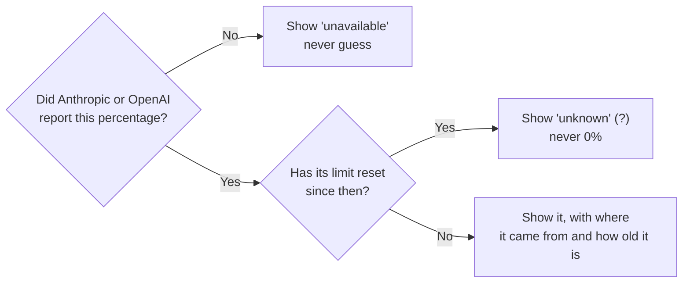

# Contributing

How to build, test and change AI Usage Meter. Written for future me and anyone else
who wants to help.

---

## The 4 rules

Every change must follow these. They are the whole point of the app.



1. **Never guess a limit.** Only show a percentage Anthropic or OpenAI reported.
   Token counts are not limits.
2. **Always say where a number came from and how old it is.**
3. **Old is not zero.** Check expiry against the current time whenever something
   is drawn, not only when data is loaded.
4. **Nothing online unless the user turns it on.** Today that means only the live
   Claude check.

---

## Setup

You need Apple's free Command Line Tools. Xcode isn't required:

```bash
xcode-select --install
git clone https://github.com/PrajwalSR/ai_usage_meter.git
cd ai_usage_meter
```

## Build, run, test

```bash
./build-app.sh                                 # builds "build/AI Usage Meter.app"
pkill -f "AI Usage Meter.app/Contents/MacOS"   # stop the running copy
open "build/AI Usage Meter.app"                # start the new one

./scripts/run-tests.sh                         # regression tests (made-up data)
./build/AIUsageMeter --scan                    # print numbers without the UI
./scripts/render-screenshots.sh                # regenerate README screenshots
```

**After every rebuild, macOS asks for Keychain access again** if the live check is
on. That's normal. Click **Always Allow**.

### Why not Xcode or `swift build`?

This project was built with Command Line Tools only (Swift 6.4, macOS 27 SDK).
Two things failed there, and the code works around both:

| Tried | What happened | Workaround |
|---|---|---|
| `swift build` | The package manifest failed to link: `Undefined symbols … PackageDescription.Package.__allocating_init`. This happened with every tools version tried (5.9–6.2). | `build-app.sh` calls `swiftc` directly |
| SwiftUI `@State` | `plugin for module 'SwiftUIMacros' not found`. The plugin ships with full Xcode. | The panel takes plain values; `UsageStore.onChange` triggers redraws |

`@Observable` (Observation macros) *was* available, but it's avoided too, so the
code doesn't depend on which macros a given toolchain has. With full Xcode
installed, SwiftPM and these macros may well work. `Package.swift` is kept so
editors can open the project.

---

## Tests

`Tests/main.swift` is a small test runner (XCTest needs full Xcode). It's compiled
with every app source except the app's `main.swift`.

**Only use made-up data in tests.** Never read real files from `~/.claude`,
`~/.codex` or `~/Library/Application Support/AIUsageMeter`. The log files hold
your conversations, and a test that reads your real readings passes or fails for
the wrong reasons — that happened once, with `ClaudeReadings.load()` defaults.
Always pass explicit temp paths.

What's covered today:

| Area | Checks |
|---|---|
| Line reading | Oversized lines skipped (inside one chunk, and across chunks) with the offset right; half-written lines aren't counted; resuming reads only new lines |
| Expiry | Unknown instead of 0%; a number turns to unknown when its window resets, without a rescan; expired windows are dropped |
| Codex | All windows and `limit_id` kept; a newer reading for one limit doesn't hide another; window length taken from `window_minutes`; cached tokens not counted twice |
| Claude sources | Separate files per source; claude.ai beats the others when recent; a fresh api.anthropic.com check beats a newer status-line reading; a stale one doesn't; an expired one never hides a valid one; old file formats load |
| claude.ai parsing | Real windows kept, internal code-name entries ignored, unfamiliar-but-real limits kept under their own name |
| Staleness | A window with no reset time goes stale once older than its own length (Anthropic omits the reset at 0%) |
| Rate limits | Backoff grows 15 → 30 → 60 min and stops there |
| Database | Rollback removes tokens *and* offsets; per-file savepoint; write errors throw; schema version in the file name; reopening keeps data; a pass refuses a mismatched schema |
| Instance lock | A second copy is refused until the first releases |

**Add a test with every bug fix.** Write it so it fails before your fix.

## Manual checks

- Menu bar shows both logos and numbers, in Light and Dark mode
- Panel footer has no orange errors
- Signed in to claude.ai: the Claude card says "From claude.ai · …" and updates about every minute
- Not signed in: the panel offers **Sign in to Claude for live updates**
- With the backup check on: it fills in when claude.ai has no recent answer
- `statusline/debug.log` records sign-in and request events, never cookies
- `--scan` numbers match Claude's `/usage` screen and your Codex usage

---

## Where to make changes

| I want to… | Look at |
|---|---|
| Change how the panel looks | `UsagePanel.swift` |
| Change the menu bar text | `UsageStore.menuBarText` |
| Change the menu bar logos | `ProviderIcons.swift`, `assets/` |
| Decide which Claude source wins | `ClaudeReadings.choose` |
| Fix the claude.ai sign-in window | `ClaudeWebSession.swift` |
| Fix claude.ai field mapping | `ClaudeWebSource.swift` (check `statusline/claude-web-raw.json`) |
| Change the cache schema | `Database.swift`: bump `schemaVersion` (the file name follows) |
| Fix the live Claude check | `ClaudeLiveUsage.swift` |
| Fix Codex numbers | `CodexParser.swift` |
| Change which window is the big number | `Provider.headline` in `Models.swift` |
| Change how often things refresh | `ClaudeLiveUsage.pollInterval`, the 30 s timer in `UsageStore`, `FileWatcher` debounce |
| Change the app icon | `assets/app-icon.svg`, then `./scripts/make-app-icon.sh` |

Full map: [docs/ARCHITECTURE.md](docs/ARCHITECTURE.md).

### Adding a provider (like Gemini)

1. Add a case to `Provider` in `Models.swift`, with its display name and headline
   rule.
2. Write a parser that follows `LogParser`.
3. Only produce an `AllowanceReading` if the provider itself reports a
   percentage (rule 1).
4. Add it to the pass in `UsageIndex.refresh` and to `UsageReport`.
5. Add a card in `UsagePanel.swift` and a logo in `assets/` (with attribution in
   `assets/README.md`).
6. Document the format in [docs/DATA-SOURCES.md](docs/DATA-SOURCES.md).
7. Add tests with made-up log lines.

---

## Code style

- Comments explain **why**, not what.
- Keep private data out of logs, errors and files: no logins, no chat text.
- **Never use `URLSession.shared`.** It saves requests to disk, login header
  included. See [SECURITY.md](SECURITY.md#past-issues).
- **Never read the claude.ai cookie, or any browser's cookie store.** Ask from
  inside the signed-in page instead, so the web view attaches its own cookie.
- Database writes must `throw` on failure. Don't swallow them with `try?`.
- Match the style of the file you're editing.

## Before opening a pull request

- [ ] `./build-app.sh` builds with no errors
- [ ] `./scripts/run-tests.sh` passes, with a new test if you fixed a bug
- [ ] The app works in Light and Dark mode
- [ ] If you touched network, Keychain or file code, the [SECURITY.md](SECURITY.md) checklist passes
- [ ] Docs and comments match what the code does
