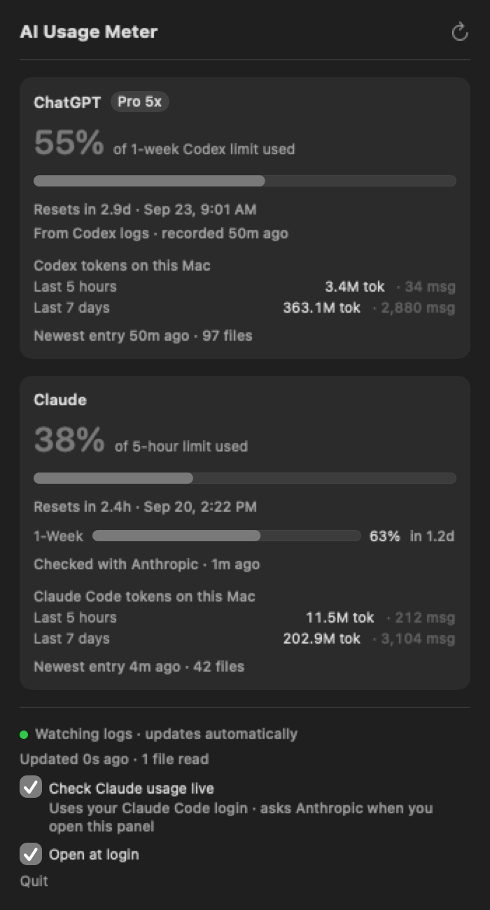
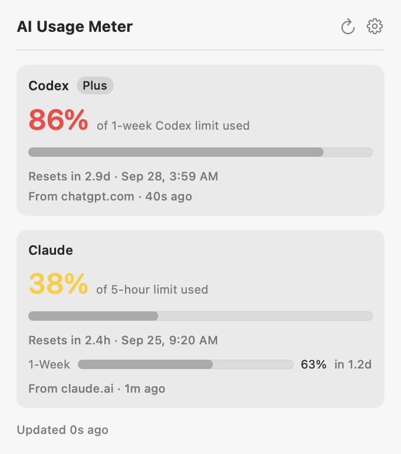
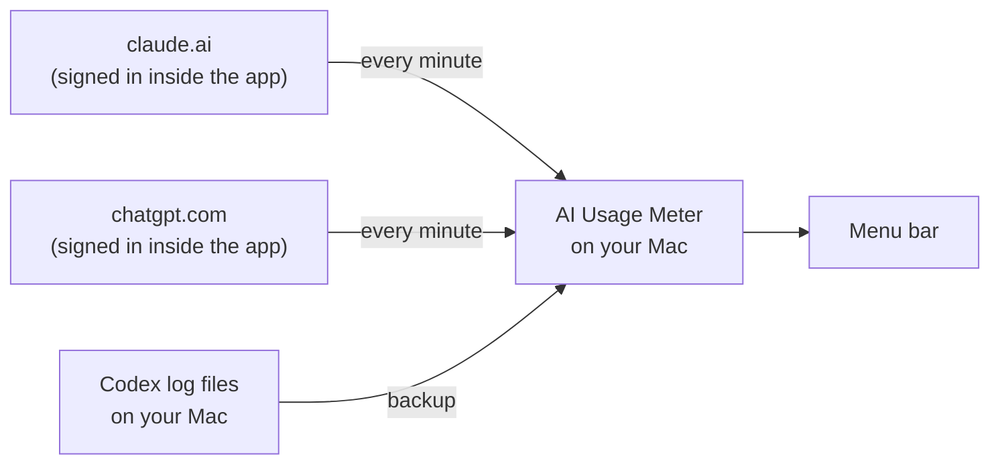
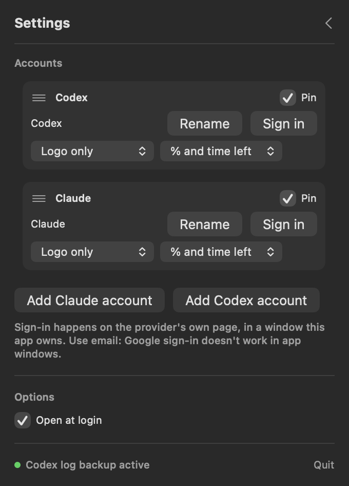
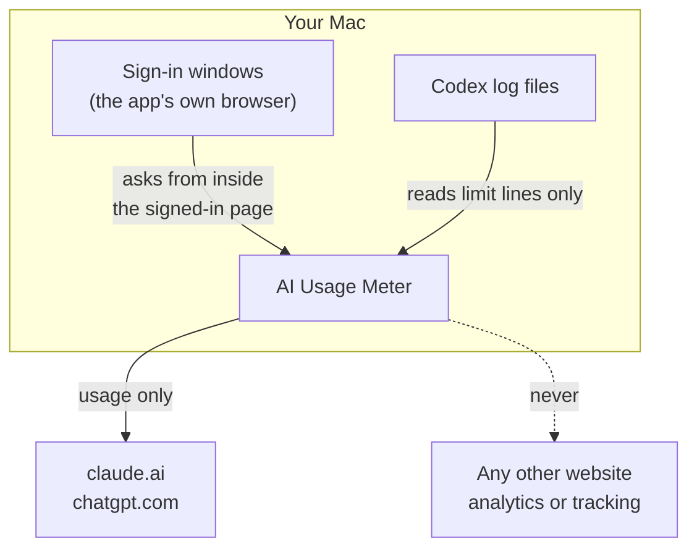

# AI Usage Meter

A small Mac app that sits in your menu bar and shows how much of your **Claude**
and **ChatGPT (Codex)** limits you have used, and when they reset.


> **Early build.** It works on my Mac and I use it every day, but it hasn't been
> tested widely yet. Apple silicon, macOS 14 or newer.

---

## Why I built this

When I work with Claude and Codex, my usage keeps going down and I wanted to see
it quickly. The apps I tried were not customizable, and most of them cost money.
So I built my own.

---

## What you see

### In the menu bar

| Logo | Example | Meaning |
|---|---|---|
| OpenAI | `86% in 2d 21h` | You used 86% of your weekly **Codex** limit. It resets in 2 days 21 hours. |
| Claude | `38% in 2h 21m` | You used 38% of your **5-hour** Claude limit. It resets in 2 hours 21 minutes. |
| Either | `?` | The last number is out of date because the limit has reset since then. It's not shown as 0%. |
| Either | `—` | No number available yet. |

The percentage changes color as you use more:

| Used | Color |
|---|---|
| under 25% | normal (white in dark mode, black in light mode) |
| 25–49% | yellow |
| 50–79% | orange |
| 80% and up | red |

The logos, names and countdown stay in the normal menu bar color. (If you show
only the time left, the time is colored instead.)

### Change how each account looks

Every pinned account has two menus under ⚙ → **Accounts**:

| Menu | Choices |
|---|---|
| Label | **Logo and name** (default) · Logo only · Name only · Numbers only |
| Value | **% and time left** (default) `38% in 2h 21m` · % only `38%` · Time left only `2h 21m` · All limits `38% · 63%` |

**All limits** shows every limit the account currently reports, shortest first,
each in its own color. An account with a 5-hour and a weekly limit shows two
numbers; a weekly-only account shows one. A limit that has reset drops out on its
own.

### When you click it

<p>
  
  
</p>

*(Screenshots use made-up numbers. Regenerate them with
`./scripts/render-screenshots.sh`.)*

Every number shows **where it came from** and **how old it is**, like "From
claude.ai · 30s ago" or "From Codex logs · recorded 50m ago". The panel uses the
same colors as the menu bar.

The app shows limits only. It does **not** count tokens, and it never reads your
Claude Code conversations.

---

## How it works



You can add more than one Claude or Codex account. Each one signs in through a
separate window and keeps its own browser session. The app checks signed-in
accounts **every minute**, using the numbers each site's own Usage page shows.
Each limit is account-wide, so use on another device shows up here too.

There's no server and no extra account. It all runs on your Mac.

### Sources, best first

| Provider | Source | How fresh | Needs |
|---|---|---|---|
| Claude | **claude.ai** | Every minute | Signing in once, in the app's own window |
| Claude | [Claude Code status line](#claude-without-signing-in) (backup) | Only while Claude Code runs in Terminal | A line in your Claude Code settings |
| ChatGPT | **chatgpt.com** | Every minute | Signing in once, in the app's own window |
| ChatGPT | Codex log files (backup) | Only when Codex runs on this Mac | Nothing: Codex writes them anyway |

A backup is only used when the main source has nothing recent. Signing in is
optional for ChatGPT: without it, the app still works from Codex's logs.

The app never reads anything from your Keychain, so macOS never asks for Keychain
access.

---

## Install

You need:
- A Mac with Apple silicon (M1, M2, M3…) on **macOS 14 or newer**
- Apple's free developer tools. If you don't have them, run:
  ```bash
  xcode-select --install
  ```

Then:

```bash
git clone https://github.com/PrajwalSR/ai_usage_meter.git
cd ai_usage_meter
./build-app.sh
open "build/AI Usage Meter.app"
```

You don't need a paid Apple Developer account.

### Sign in (do this once)



1. Click the menu bar item, then the **⚙** gear.
2. Under **Accounts**, click **Sign in** next to Claude or ChatGPT.
3. That site's real sign-in page opens in a window this app owns. Sign in with
   **your email**.
4. Once the app gets its first number, the window closes by itself and the
   numbers update every minute.

For another account, click **Add Claude account** or **Add Codex account** under
**Accounts**, then sign in to that account. Rename it so you can tell your
accounts apart. Tick **Pin** on any accounts you want to see in the menu bar;
you can pin as many as you like, though macOS may hide menu bar items if there
isn't enough screen space. Unpinned accounts remain in the dropdown and keep
updating. Drag an account up or down to change the order; the others slide
aside and a line shows where it will land. The usage cards and menu bar items
follow it. Removing an added account also clears its saved sign-in on this Mac.

> **"Continue with Google" will not work here.** Google refuses to sign you in
> inside an app window like this one. Use the email option.

The app never sees your password: you type it on the provider's own page. See
[Is it safe?](#is-it-safe).

To start the app when your Mac starts, tick **Open at login** on the same page.

---

## Claude without signing in

If you'd rather not sign in to claude.ai in the app, Claude Code can pass your
usage to a small script instead. This is an
[official Claude Code feature](https://code.claude.com/docs/en/statusline).

**1.** Open `~/.claude/settings.json` and add this. Use the real path to where you
cloned the project:

```json
{
  "statusLine": {
    "type": "command",
    "command": "/Users/YOUR_NAME/ai_usage_meter/scripts/claude-statusline.py",
    "padding": 0
  }
}
```

If the file already has other settings, add just the `"statusLine": {...}` part
inside the existing `{ }`.

**2.** Start Claude Code **in Terminal** (`claude`) and send one message.

**3.** You'll see a line at the bottom of Claude Code like `Opus 5 · 5h 38% · 7d 63%`,
and the meter picks up the same numbers.

The catch: this only works in the **Terminal** version of Claude Code, not the
Claude desktop app or VS Code, and it only updates while Claude Code is running.
Pro and Max plans only.

To undo it, delete the `"statusLine"` part from `~/.claude/settings.json`.

---

## Is it safe?



| Question | Answer |
|---|---|
| Does it see my password? | No. You type it on the provider's own sign-in page, inside a window the app shows but doesn't read. |
| Where do my sessions live? | In the app's own browser storage, like any browser. **The app never reads or copies them**: it asks for usage *from inside* the signed-in page, so the page attaches its own cookie. Other apps of this kind lift the cookie out of Safari's or Chrome's cookie database; this one doesn't. |
| Does it touch my Keychain? | No. It never reads the Keychain, including Claude Code's saved login. |
| Does it contact the internet? | Only claude.ai and chatgpt.com, about once a minute per signed-in account, for usage. Nothing else, ever. |
| Does it read my chats? | **It never opens Claude Code's logs.** It reads Codex's logs, which do hold your Codex conversations, but only looks at lines carrying the limit numbers and saves only those. |
| Does it track me? | No. No analytics, no tracking, no crash reports. |
| How do I sign out? | Open the sign-in window and sign out there, or delete `~/Library/Application Support/AIUsageMeter/`. |

Full details: [SECURITY.md](SECURITY.md).

---

## Good to know

**The ChatGPT number is your Codex limit.**
It's the Codex usage limit that comes with your ChatGPT plan. Normal chats on
chatgpt.com have their own limits, which aren't shown here.

**Both numbers cover every device once you sign in.**
Claude's limit is shared by claude.ai, the phone app, the desktop app and Claude
Code; the Codex limit is shared across machines. Signed in, this Mac shows use from
anywhere within a minute.

**Without the ChatGPT sign-in, that number only updates when Codex runs here.**
Codex writes its limit to log files on this Mac only while it runs. The card
always shows how old the number is.

**It never guesses.**
The app shows only percentages Anthropic or OpenAI reported. It doesn't count
tokens or work a percentage out for itself. With no real number, it says
"unavailable".

**The website addresses aren't published APIs.**
claude.ai and chatgpt.com could change them one day. If they do, the app falls
back to the other sources and says where each number came from.

**A number disappears when it gets too old.**
Anthropic doesn't always send a reset time for the 5-hour window (it leaves it out
at 0%). A 5-hour figure can't describe a moment more than 5 hours later, so the
app drops it rather than show a stale 0%.

---

## Common problems

| What you see | What to do |
|---|---|
| "Continue with Google" shows a sign-in error | Google blocks sign-in inside app windows. Use the email option. |
| An account shows **Sign in** again | That site's session expired. Click **Sign in** and sign in once more. |
| Claude says "Usage unavailable" | Sign in to Claude under ⚙ → Accounts, or set up [the status line](#claude-without-signing-in). |
| ChatGPT number is old, or shows `?` | Sign in to ChatGPT under ⚙ → Accounts, or use Codex once and it updates. |
| Claude's 5-hour row is missing | The last reading is older than 5 hours, so it can't be trusted. It returns at the next successful check. |
| Numbers are a bit different from another app | Compare how old each number is. Numbers taken minutes apart differ. |
| Doesn't open at login after moving the app | Untick and tick **Open at login** again. |
| "AI Usage Meter is already running" | Only one copy can run. Look for it in the menu bar, or quit it first. |

---

## Settings

| What | How |
|---|---|
| Live Claude and ChatGPT numbers | ⚙ → **Accounts** → **Sign in** |
| Start at login | ⚙ → **Open at login** |
| Show your Claude plan name | `defaults write local.aiusagemeter claudePlanLabel "Pro"` |
| Start fresh | Quit the app, then run `./build/AIUsageMeter --scan --rebuild`, or delete `~/Library/Application Support/AIUsageMeter/`. Open it again. |

---

## For developers

| Document | What's inside |
|---|---|
| [CONTRIBUTING.md](CONTRIBUTING.md) | Build, test, the rules every change follows |
| [docs/ARCHITECTURE.md](docs/ARCHITECTURE.md) | How the code is organized and how data flows |
| [docs/DATA-SOURCES.md](docs/DATA-SOURCES.md) | The exact files, fields and addresses the app uses |
| [SECURITY.md](SECURITY.md) | What the app touches and how it keeps it safe |
| [assets/README.md](assets/README.md) | Icons, logos and how to rebuild the app icon |
| [docs/OPEN-SOURCE-CHECKLIST.md](docs/OPEN-SOURCE-CHECKLIST.md) | Things to do before making this public |

Quick commands:

```bash
./build-app.sh                   # build the app
./scripts/run-tests.sh           # run the tests (made-up data only)
./build/AIUsageMeter --scan      # print the numbers without opening the app
```

---

## License

MIT. See [LICENSE](LICENSE).

Claude and Anthropic are trademarks of Anthropic. OpenAI, ChatGPT and Codex are
trademarks of OpenAI. This project isn't made by or connected to either company.
