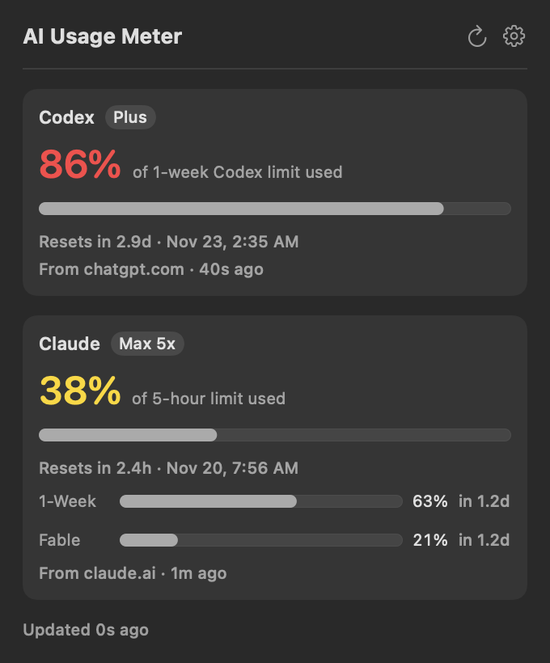
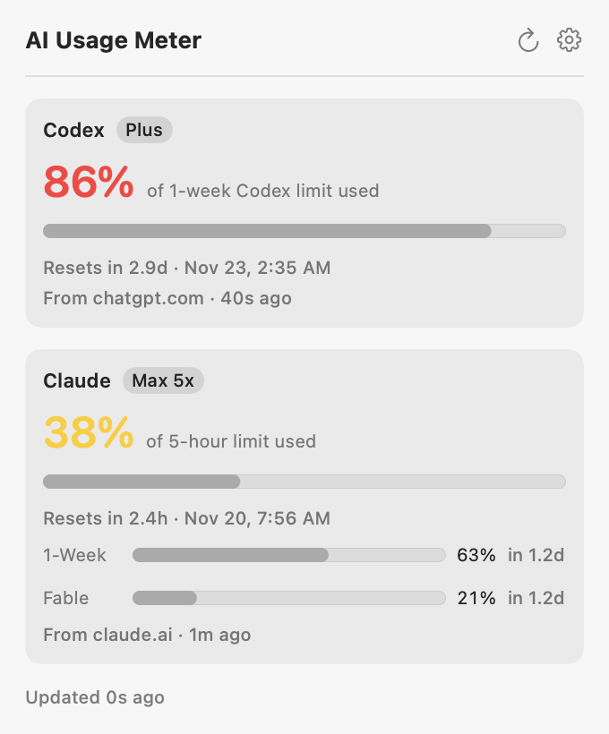
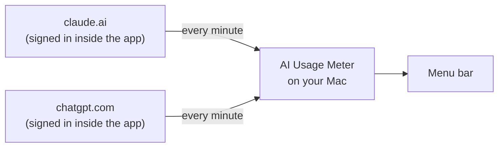
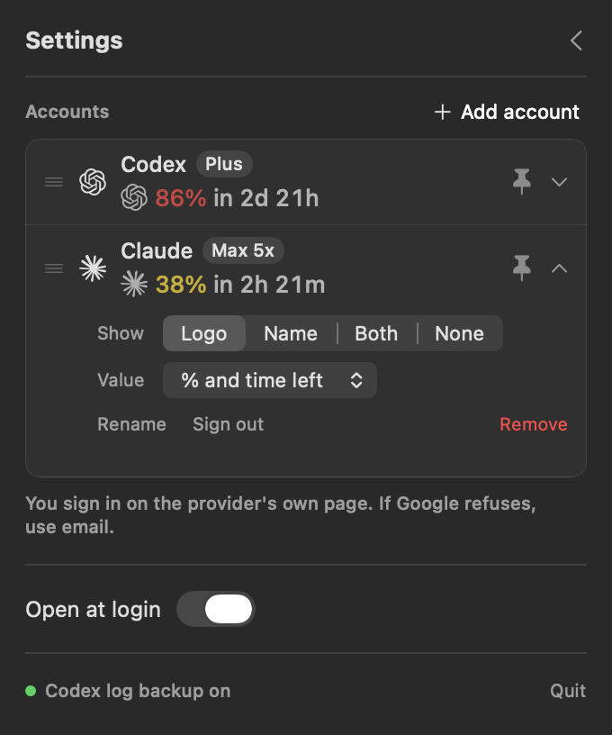
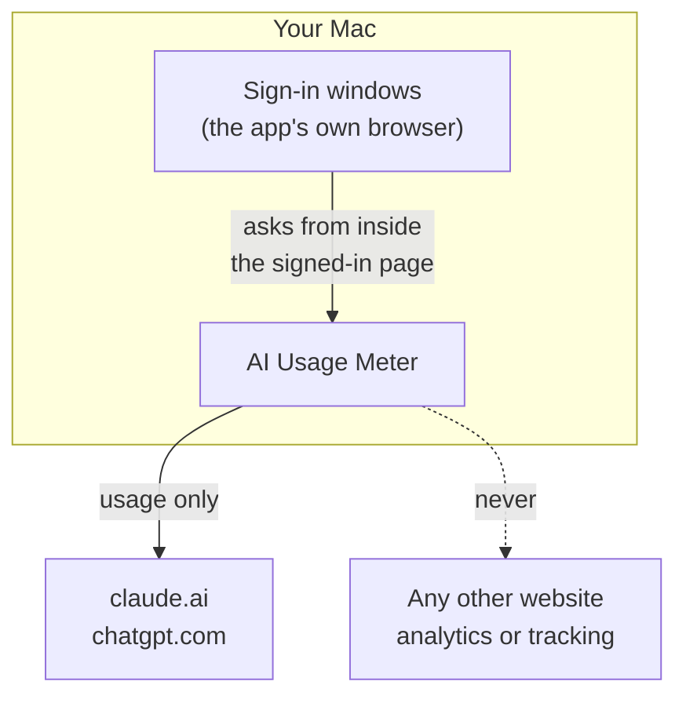

# AI Usage Meter

A small Mac app that sits in your menu bar and shows how much of your **Claude**
and **ChatGPT (Codex)** limits you have used, and when they reset.


> **Early build.** It works on my Mac and I use it every day, but it hasn't been
> tested widely yet. Apple silicon, macOS 14 or newer.

**[Download the latest release](https://github.com/PrajwalSR/ai_usage_meter/releases/latest)**
(a zip with the ready-to-run app; see [Install](#install)), or
[build it yourself](#or-build-it-yourself).

---

## Why I built this

When I work with Claude and Codex, my usage keeps going down and I wanted to see
it quickly. The apps I tried were not customizable, and most of them cost money.
So I built my own.

---

## What you see

### In the menu bar

| Logo | Example | Meaning |
|---|---|---|
| OpenAI | `86% in 2d 21h` | You used 86% of your weekly **Codex** limit. It resets in 2 days 21 hours. |
| Claude | `38% in 2h 21m` | You used 38% of your **5-hour** Claude limit. It resets in 2 hours 21 minutes. |
| Either | `?` | The last number is out of date because the limit has reset since then. It's not shown as 0%. |
| Either | `—` | No number available yet. |
| Either | `⚠︎` | You're signed out of that account's website, or it isn't answering. Open the panel to see what's wrong. |

The percentage changes color as you use more:

| Used | Color |
|---|---|
| under 25% | normal (white in dark mode, black in light mode) |
| 25–49% | yellow |
| 50–79% | orange |
| 80% and up | red |

The logos, names and countdown stay in the normal menu bar color. (If you show
only the time left, the time is colored instead.)

### Change how each account looks

Under ⚙ → **Accounts**, each account's row shows exactly what it puts in the
menu bar right now. Click the row to open its options; the preview changes as
you pick:

| Option | Choices |
|---|---|
| Show | Logo · Name · **Both** (default) · None (numbers only) |
| Value | **% and time left** (default) `38% in 2h 21m` · % only `38%` · Time left only `2h 21m` · All limits `38% · 63%` |

**All limits** shows every limit the account currently reports, shortest first,
each in its own color. On plans with a weekly limit for one model (for example
**Fable** on Max), that limit gets its own row on the card, under 1-Week, and is
included in All limits.

The Codex card also names any separate limit chatgpt.com reports (such as
**Code review**), and shows how many **limit resets** your ChatGPT account has
and when the next one expires ("1 limit reset available · expires Dec 12,
5:19 PM"), so you can plan when to use it. With several resets, hover over the
line to see every expiry date. That line is information only: the
app never uses a reset, and can't. Use one on chatgpt.com when you need it. An account with a 5-hour and a weekly limit shows two
numbers; a weekly-only account shows one. A limit that has reset drops out on its
own.

### When you click it

<p>
  
  
</p>

*(Screenshots use made-up numbers. Regenerate them with
`./scripts/render-screenshots.sh`.)*

Every number shows **where it came from** and **how old it is**, like "From
claude.ai · 30s ago" or "From chatgpt.com · 2m ago". The panel uses the
same colors as the menu bar.

The app shows limits only. It does **not** count tokens, and it never reads your
Claude Code or Codex conversations.

---

## How it works



You can add more than one Claude or Codex account. Each one signs in through a
separate window and keeps its own browser session. The app checks signed-in
accounts **every minute**, using the numbers each site's own Usage page shows.
Each limit is account-wide, so use on another device shows up here too.

There's no server and no extra account. It all runs on your Mac.

### Sources, best first

| Provider | Source | How fresh | Needs |
|---|---|---|---|
| Claude | **claude.ai** | Every minute | Signing in once, in the app's own window |
| Claude | [Claude Code status line](#claude-without-signing-in) (backup) | Only while Claude Code runs in Terminal | A line in your Claude Code settings |
| ChatGPT | **chatgpt.com** | Every minute | Signing in once, in the app's own window |

The backup is only used when claude.ai has nothing recent. ChatGPT has no
backup: sign in to see its usage. The app never reads Codex's files in
`~/.codex`.

The app never reads anything from your Keychain, so macOS never asks for Keychain
access.

---

## Install

You need a Mac with Apple silicon (M1, M2, M3…) on **macOS 14 or newer**.

### Download it (easiest)

1. Download **AI-Usage-Meter-*version*.zip** from the
   [latest release](https://github.com/PrajwalSR/ai_usage_meter/releases/latest).
2. Double-click the zip, then drag **AI Usage Meter** to your Applications folder.
3. Open it. The first time, macOS says it can't check the app for malicious
   software, because the app isn't signed with a paid Apple Developer ID. Click
   **Done**.
4. Open **System Settings → Privacy & Security**, scroll down, and click
   **Open Anyway** next to AI Usage Meter. Confirm with your password.

You only do this once; after that it opens normally. To update, quit the app,
download the new zip and replace the old copy. Your accounts and sign-ins carry
over.

### Or build it yourself

If you'd rather not run a downloaded app, build it from the source. You need
Apple's free developer tools. If you don't have them, run:

```bash
xcode-select --install
```

Then:

```bash
git clone https://github.com/PrajwalSR/ai_usage_meter.git
cd ai_usage_meter
./build-app.sh
open "build/AI Usage Meter.app"
```

You don't need a paid Apple Developer account.

### Sign in (do this once)



1. Click the menu bar item, then the **⚙** gear.
2. Under **Accounts**, click **+ Add account** and choose Claude or Codex. (To
   sign an existing account back in, click its row, then **Sign in**.)
3. That site's real sign-in page opens in a window this app owns. Sign in with
   **your email**.
4. As soon as you're signed in and the app gets its first number, the window
   closes by itself and the numbers update every minute.

Add as many accounts as you like the same way. Each account is one row: its
logo, name, plan, and a preview of what it shows in the menu bar.

- **Pin** (the pin icon) puts an account in the menu bar. Pin as many as you
  like, though macOS may hide menu bar items if there isn't enough space.
  Unpinned accounts say "Not in menu bar", stay in the dropdown and keep
  updating.
- **Click a row** to open it: choose what it shows in the menu bar, **Rename**
  it in place, **Sign out** (erases its saved sign-in, keeps it in the list) or
  **Remove** it (also clears its saved sign-in on this Mac). One row is open at
  a time.
- **Drag** a row up or down to change the order; the usage cards and menu bar
  items follow it.

> **"Continue with Google"** opens Google's sign-in in a small popup window.
> If Google ever answers "This browser or app may not be secure", use the
> email option instead.

The app never sees your password: you type it on the provider's own page. See
[Is it safe?](#is-it-safe).

To start the app when your Mac starts, turn on **Open at login** on the same page.

---

## Claude without signing in

If you'd rather not sign in to claude.ai in the app, Claude Code can pass your
usage to a small script instead. This is an
[official Claude Code feature](https://code.claude.com/docs/en/statusline).

**1.** Open `~/.claude/settings.json` and add this. Use the real path to where you
cloned the project:

```json
{
  "statusLine": {
    "type": "command",
    "command": "/Users/YOUR_NAME/ai_usage_meter/scripts/claude-statusline.py",
    "padding": 0
  }
}
```

If the file already has other settings, add just the `"statusLine": {...}` part
inside the existing `{ }`.

**2.** Start Claude Code **in Terminal** (`claude`) and send one message.

**3.** You'll see a line at the bottom of Claude Code like `Opus 5 · 5h 38% · 7d 63%`,
and the meter picks up the same numbers.

The catch: this only works in the **Terminal** version of Claude Code, not the
Claude desktop app or VS Code, and it only updates while Claude Code is running.
Pro and Max plans only.

To undo it, delete the `"statusLine"` part from `~/.claude/settings.json`.

---

## Is it safe?



| Question | Answer |
|---|---|
| Does it see my password? | No. You type it on the provider's own sign-in page, inside a window the app shows but doesn't read. |
| Where do my sessions live? | In the app's own browser storage, like any browser. **The app never reads or copies them**: it asks for usage *from inside* the signed-in page, so the page attaches its own cookie. Other apps of this kind lift the cookie out of Safari's or Chrome's cookie database; this one doesn't. |
| Does it touch my Keychain? | No. It never reads the Keychain, including Claude Code's saved login. |
| Does it contact the internet? | Only claude.ai and chatgpt.com, about once a minute per signed-in account, for usage. Nothing else, ever. |
| Does it read my chats? | **No.** It never opens Claude Code's or Codex's logs, which hold your conversations. |
| Does it track me? | No. No analytics, no tracking, no crash reports. |
| How do I sign out? | ⚙ → **Accounts** → **Sign out** on that account. It erases that account's cookies and site data; **Remove** (the bin) also drops the account. |

Full details: [SECURITY.md](SECURITY.md).

---

## Good to know

**The ChatGPT number is your Codex limit.**
It's the Codex usage limit that comes with your ChatGPT plan. Normal chats on
chatgpt.com have their own limits, which aren't shown here.

**Both numbers cover every device once you sign in.**
Claude's limit is shared by claude.ai, the phone app, the desktop app and Claude
Code; the Codex limit is shared across machines. Signed in, this Mac shows use from
anywhere within a minute.

**It never guesses.**
The app shows only percentages Anthropic or OpenAI reported. It doesn't count
tokens or work a percentage out for itself. With no real number, it says
"unavailable".

**The website addresses aren't published APIs.**
claude.ai and chatgpt.com could change them one day. If they do, the app falls
back to the other sources and says where each number came from.

**A number disappears when it gets too old.**
Anthropic doesn't always send a reset time for the 5-hour window (it leaves it out
at 0%). A 5-hour figure can't describe a moment more than 5 hours later, so the
app drops it rather than show a stale 0%.

---

## Common problems

| What you see | What to do |
|---|---|
| macOS says it "can't check AI Usage Meter for malicious software" | Expected for the downloaded app, which isn't signed with a paid Apple Developer ID. Click **Done**, then **System Settings → Privacy & Security → Open Anyway**. You only do this once. |
| "Continue with Google" shows "This browser or app may not be secure" | Google refused this window. Use the email option. |
| An account shows **Sign in** again, or `⚠︎` in the menu bar | That site's session expired or it stopped answering. Click **Sign in** and sign in once more. |
| Claude says "Usage unavailable" | Sign in to Claude under ⚙ → Accounts, or set up [the status line](#claude-without-signing-in). |
| ChatGPT number is old, or shows `?` | Sign in to ChatGPT again under ⚙ → Accounts. |
| Claude's 5-hour row is missing | The last reading is older than 5 hours, so it can't be trusted. It returns at the next successful check. |
| Numbers are a bit different from another app | Compare how old each number is. Numbers taken minutes apart differ. |
| Doesn't open at login after moving the app | Turn **Open at login** off and on again. |
| "AI Usage Meter is already running" | Only one copy can run. Look for it in the menu bar, or quit it first. |

---

## Settings

| What | How |
|---|---|
| Live Claude and ChatGPT numbers | ⚙ → **Accounts** → **Sign in** |
| Start at login | ⚙ → **Open at login** |
| Claude plan name without signing in | Signed-in accounts show their plan (Pro, Max 5x, Max 20x…) on their own. For the status line only: `defaults write io.github.prajwalsr.aiusagemeter claudePlanLabel "Max"` |
| Start fresh | Quit the app, then run `./build/AIUsageMeter --scan --rebuild`, or delete `~/Library/Application Support/AIUsageMeter/`. Open it again. |

---

## For developers

| Document | What's inside |
|---|---|
| [CONTRIBUTING.md](CONTRIBUTING.md) | Build, test, the rules every change follows |
| [docs/ARCHITECTURE.md](docs/ARCHITECTURE.md) | How the code is organized and how data flows |
| [docs/DATA-SOURCES.md](docs/DATA-SOURCES.md) | The exact files, fields and addresses the app uses |
| [SECURITY.md](SECURITY.md) | What the app touches and how it keeps it safe |
| [assets/README.md](assets/README.md) | Icons, logos and how to rebuild the app icon |

Quick commands:

```bash
./build-app.sh                   # build the app
./scripts/run-tests.sh           # run the tests (made-up data only)
./build/AIUsageMeter --scan      # print the numbers without opening the app
```

---

## License

MIT. See [LICENSE](LICENSE).

Claude and Anthropic are trademarks of Anthropic. OpenAI, ChatGPT and Codex are
trademarks of OpenAI. This project isn't made by or connected to either company.
