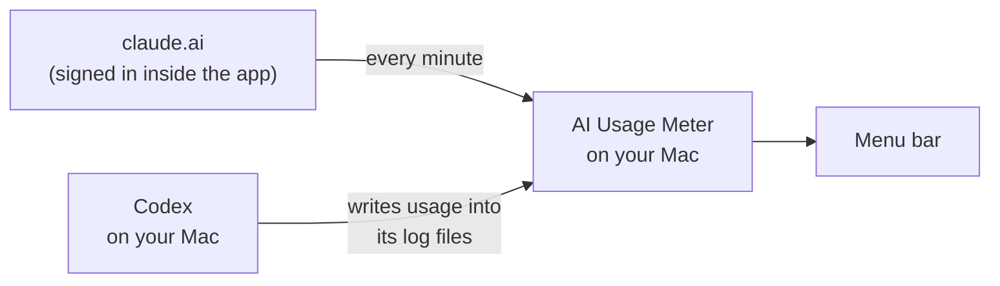
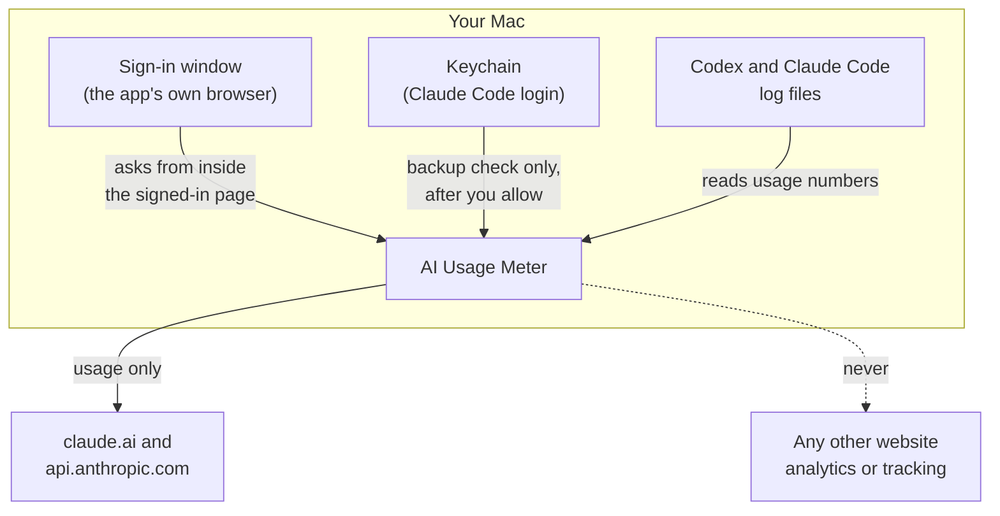

# AI Usage Meter

A small Mac app that sits in your menu bar and shows how much of your **Claude**
and **ChatGPT (Codex)** limits you have used, and when they reset.


> **Early personal-use build.** It works on my Mac and I use it every day, but it
> hasn't been tested widely yet. Apple silicon, macOS 14 or newer.

---

## Why I built this

When I work with Claude and Codex, my usage keeps going down and I wanted to see
it quickly. The apps I tried were not customizable, and most of them cost money.
So I built my own.

---

## What you see

### In the menu bar

| Logo | Example | Meaning |
|---|---|---|
| OpenAI | `55% in 2d 21h` | You used 55% of your weekly **Codex** limit. It resets in 2 days 21 hours. |
| Claude | `38% in 2h 21m` | You used 38% of your **5-hour** Claude limit. It resets in 2 hours 21 minutes. |
| Either | `?` | The last number is out of date because the limit has reset since then. It's not shown as 0%. |
| Either | `—` | No number available yet. |

The logos and text turn white in dark mode and black in light mode.

### When you click it

<p>
  
  
</p>

*(Screenshots use made-up numbers. Regenerate them with
`./scripts/render-screenshots.sh`.)*

Every number shows **where it came from** and **how old it is**, like "Checked
with Anthropic · 1m ago" or "From Codex logs · recorded 50m ago".

---

## How it works



- **ChatGPT (Codex):** Codex saves your limit in its log files on your Mac while it
  runs. The app reads those files. No login and no internet needed.
- **Claude:** your limit isn't in any local file, so the app asks Claude for it.
  You sign in to claude.ai once, in a window the app owns, and then it reads your
  usage **every minute** — the same numbers the Usage screen in the Claude app
  shows.

There's no server and no extra account. It all runs on your Mac.

### Claude has three sources, best first

| Source | How fresh | Needs |
|---|---|---|
| **claude.ai** (normal) | Every minute | Signing in once, in the app's own window |
| api.anthropic.com (backup) | Every 30 min at most | The login Claude Code already saved |
| [Claude Code status line](#claude-without-live-checks) (backup) | Only while Claude Code runs in Terminal | A line in your Claude Code settings |

The backup exists because api.anthropic.com **rate-limits** this kind of request
hard: ask too often and it refuses for up to an hour. claude.ai's own endpoint is
the one the website itself uses, so it can be asked every minute.

---

## Install

You need:
- A Mac with Apple silicon (M1, M2, M3…) on **macOS 14 or newer**
- Apple's free developer tools. If you don't have them, run:
  ```bash
  xcode-select --install
  ```
- **Codex** and/or **Claude Code** installed and logged in

Then:

```bash
git clone https://github.com/PrajwalSR/ai_usage_meter.git
cd ai_usage_meter
./build-app.sh
open "build/AI Usage Meter.app"
```

You don't need a paid Apple Developer account.

### Sign in to Claude (do this once)

1. Click the menu bar item.
2. Click **Sign in to Claude for live updates**.
3. Anthropic's real sign-in page opens in a window this app owns. Sign in with
   **your email** and the code they send you.
4. Close that window. The app keeps you signed in and starts reading your usage
   every minute.

> **"Continue with Google" will not work here.** Google refuses to sign you in
> inside an app window like this one. Use the email option.

The app never sees your password: you type it on Anthropic's own page. See
[Is it safe?](#is-it-safe).

### Optional: the backup check

**Check Claude usage live** in the panel uses the login Claude Code already saved
on your Mac, through api.anthropic.com. It only fills in when claude.ai has no
recent answer. macOS asks permission the first time:

> **"AI Usage Meter" wants to use your confidential information stored in
> "Claude Code-credentials" in your keychain.**

Click **Always Allow**, or **Deny** and untick the setting.

To start the app when your Mac starts, tick **Open at login**.

---

## Claude without live checks

If you'd rather the app never touch your Claude login, Claude Code can pass your
usage to a small script instead. This is an
[official Claude Code feature](https://code.claude.com/docs/en/statusline).

**1.** Open `~/.claude/settings.json` and add this. Use the real path to where you
cloned the project:

```json
{
  "statusLine": {
    "type": "command",
    "command": "/Users/YOUR_NAME/ai_usage_meter/scripts/claude-statusline.py",
    "padding": 0
  }
}
```

If the file already has other settings, add just the `"statusLine": {...}` part
inside the existing `{ }`.

**2.** Start Claude Code **in Terminal** (`claude`) and send one message.

**3.** You'll see a line at the bottom of Claude Code like `Opus 5 · 5h 38% · 7d 63%`,
and the meter picks up the same numbers.

The catch: this only works in the **Terminal** version of Claude Code, not the
Claude desktop app or VS Code, and it only updates while Claude Code is running.
Pro and Max plans only.

To undo it, delete the `"statusLine"` part from `~/.claude/settings.json`.

---

## Is it safe?



| Question | Answer |
|---|---|
| Does it see my password? | No. You type it on Anthropic's own sign-in page, inside a window the app shows but doesn't read. |
| Where does my claude.ai session live? | In the app's own browser storage, like any browser. **The app never reads or copies it**: it asks for usage *from inside* the signed-in page, so the page attaches its own cookie. Other apps of this kind lift the cookie out of Safari's or Chrome's cookie database; this one doesn't. |
| Does it contact the internet? | Only claude.ai (about once a minute, for usage) and api.anthropic.com (backup check). Nothing else, ever. |
| Does it read my chats? | The log files it reads contain your conversations. It picks out only the usage numbers and saves only those. Your messages are never saved or sent. |
| Does it track me? | No. No analytics, no tracking, no crash reports. |
| Does it need my OpenAI login? | No. ChatGPT numbers come from Codex's files on your Mac. |
| How do I sign out? | Open the sign-in window and sign out there, or delete `~/Library/Application Support/AIUsageMeter/`. |

Full details: [SECURITY.md](SECURITY.md).

---

## Good to know

**The ChatGPT number is your Codex limit.**
It's the Codex usage limit that comes with your ChatGPT plan. Normal chats on
chatgpt.com have their own limits, which aren't shown here.

**ChatGPT numbers only update when you use Codex.**
Codex only writes to its files while it runs. The panel always shows how old the
number is.

**The Claude number includes everything.**
claude.ai, the Claude desktop app and Claude Code share one limit, so the percentage
covers all of them.

**Token counts are not your limit.**
The "tokens on this Mac" rows only count Claude Code and Codex use on this Mac. The
app never works out a percentage from tokens. If it has no real number, it says
"unavailable" instead of guessing.

**Claude's numbers come from claude.ai's own usage address.**
It isn't a published API, so it could change one day. If it does, the app falls
back to the other sources and says where each number came from.

**The backup check uses an unofficial Anthropic address.**
Anthropic hasn't published it, so it could stop working one day. If that happens,
the panel shows an error instead of a wrong number.

**Anthropic limits how often that address can be asked.**
Ask too often and it answers "rate limited" for a while — once, it asked for a
41-minute wait. So the app asks rarely (see the table above), waits exactly as
long as the server says, and keeps showing the last number with its age. Press ⟳
only when you really want a fresh number.

**A number disappears when it gets too old.**
Anthropic doesn't always send a reset time for the 5-hour window (it leaves it out
at 0%). A 5-hour figure can't describe a moment more than 5 hours later, so the
app drops it rather than show a stale 0%.

---

## Common problems

| What you see | What to do |
|---|---|
| "Continue with Google" shows a sign-in error | Google blocks sign-in inside app windows. Use **Continue with email**. |
| Claude says "Sign in to Claude…" again | The claude.ai session expired. Click it and sign in once more. |
| The Keychain popup shows up again | It happens after every rebuild of the app. It's only for the backup check. Click **Always Allow**, or untick **Check Claude usage live**. |
| "Keychain access was declined" | Press ⟳ and click **Always Allow**, or untick **Check Claude usage live**. |
| "Claude Code login not found" | Log in to Claude Code first. |
| "Claude login expired" | Open Claude Code once. It refreshes the login by itself. |
| Claude says "Usage unavailable" | Turn on **Check Claude usage live**, or set up [the status line](#claude-without-live-checks). |
| ChatGPT number is old, or shows `?` | Normal. Use Codex once and it updates. |
| "Anthropic is limiting usage checks" | You've hit Anthropic's limit on usage checks. The app retries by itself at the time it names. |
| Claude's 5-hour row is missing | The last reading is older than 5 hours, so it can't be trusted. It returns at the next successful check. |
| Numbers are a bit different from another app | Compare how old each number is. Numbers taken minutes apart differ. |
| Doesn't open at login after moving the app | Untick and tick **Open at login** again. |
| "AI Usage Meter is already running" | Only one copy can run. Look for it in the menu bar, or quit it first. |

---

## Settings

| What | How |
|---|---|
| Claude numbers | **Sign in to Claude for live updates** in the panel |
| Backup check via Claude Code's login | **Check Claude usage live** in the panel (off by default) |
| Start at login | **Open at login** in the panel |
| Show your Claude plan name | `defaults write local.aiusagemeter claudePlanLabel "Pro"` |
| Start fresh | Quit the app, then run `./build/AIUsageMeter --scan --rebuild`, or delete `~/Library/Application Support/AIUsageMeter/`. Open it again. |

---

## For developers

| Document | What's inside |
|---|---|
| [CONTRIBUTING.md](CONTRIBUTING.md) | Build, test, the rules every change follows |
| [docs/ARCHITECTURE.md](docs/ARCHITECTURE.md) | How the code is organized and how data flows |
| [docs/DATA-SOURCES.md](docs/DATA-SOURCES.md) | The exact files, fields and address the app uses |
| [SECURITY.md](SECURITY.md) | What the app touches and how it keeps it safe |
| [assets/README.md](assets/README.md) | Icons, logos and how to rebuild the app icon |
| [docs/OPEN-SOURCE-CHECKLIST.md](docs/OPEN-SOURCE-CHECKLIST.md) | Things to decide before making this public |

Quick commands:

```bash
./build-app.sh                   # build the app
./scripts/run-tests.sh           # run the tests (made-up data only)
./build/AIUsageMeter --scan      # print the numbers without opening the app
```

---

## License

No license chosen yet, so all rights are reserved for now.

Claude and Anthropic are trademarks of Anthropic. OpenAI, ChatGPT and Codex are
trademarks of OpenAI. This project isn't made by or connected to either company.
