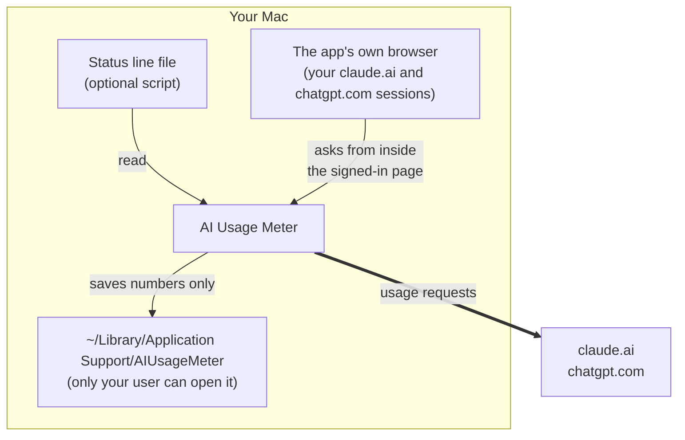
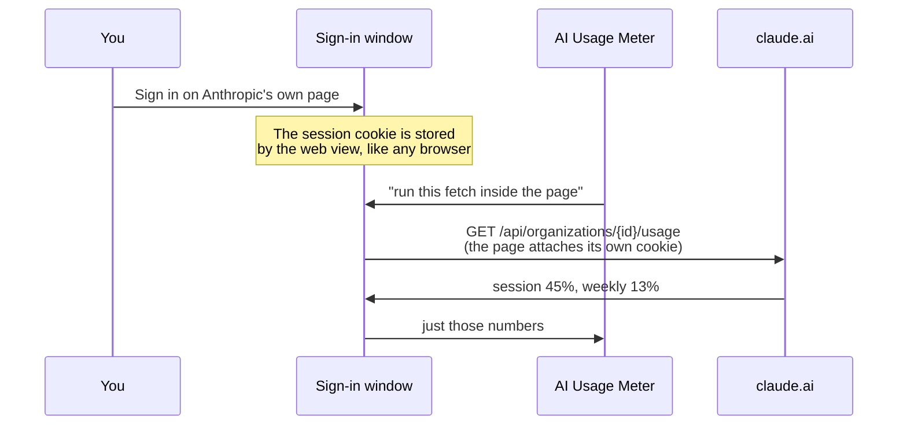

# Security

This app is close to private stuff: your signed-in claude.ai and chatgpt.com
sessions.
It does **not** read Claude Code's or Codex's logs, or either one's login. This page explains what it touches, why, and
how it keeps things safe. It also lists what it **can't** promise.

---

## Found a security problem?

Please **don't** open a public issue.

Use GitHub's private reporting instead: on the repository page, go to
**Security → Report a vulnerability**. Include what you found and how to reproduce
it. Please give reasonable time for a fix before sharing it publicly.

---

## What the app touches



| Thing | What the app does | When |
|---|---|---|
| Claude Code logs `~/.claude/projects` | **Never opened** | — |
| Codex's folder `~/.codex` (logs and login) | **Never opened** | — |
| `https://claude.ai/api/organizations…` | Sends a request from inside the signed-in page | About once a minute, only after you click **Sign in** for Claude |
| `https://chatgpt.com/api/auth/session`, `/backend-api/wham/usage`, `/backend-api/wham/rate-limit-reset-credits` | Sends requests from inside the signed-in page | About once a minute, only after you click **Sign in** for ChatGPT |
| Session cookies for both sites | **Never reads them.** They stay in the app's browser storage, which attaches them automatically | — |
| chatgpt.com's short-lived access token | Used **inside the page only**, the same way chatgpt.com's own pages use it. Never returned to the app, saved or logged | Each ChatGPT usage check |
| Keychain (including `Claude Code-credentials`) | **Never opened.** macOS never shows a Keychain prompt for this app | — |
| `~/Library/Application Support/AIUsageMeter/` | Reads and writes | Always. Folder mode `0700`. Holds the cache, reading files and `instance.lock` |
| `~/Library/Caches/local.aiusagemeter/` | **Deletes** | At launch, if present. It's the request cache left by early builds (see Past issues) |
| `statusline/claude-live.json` | **Deletes** | At launch, if present. Left by earlier builds' removed backup check |
| Older caches `cache-v1.sqlite` to `cache-v4.sqlite` | **Deletes** | At launch, if present. Builds up to 0.1 recorded the paths of the Codex logs they read there |

### What the app never does

- ❌ See your password: you type it on the provider's own page
- ❌ Read, copy or store a session cookie or access token
- ❌ Read cookies from Safari, Chrome or any other browser
- ❌ Open anything in `~/.codex`, including your OpenAI login (`auth.json`)
- ❌ Read anything from the Keychain
- ❌ Contact any website except `claude.ai` and `chatgpt.com`, and those only after you sign in
- ❌ Run commands or start other programs
- ❌ Send analytics, tracking or crash reports
- ❌ Change Claude Code's or Codex's own files
- ❌ Save your chats, prompts or code

You can check the network part yourself while the app runs:

```bash
lsof -nP -a -p "$(pgrep -f 'AI Usage Meter.app/Contents/MacOS')" -i
```

(Keep `-a`. Without it, `lsof` also lists other apps' connections.)

---

## Signing in to claude.ai and chatgpt.com

The app shows each provider's own sign-in page in a window it owns (a
`WKWebView`), and afterwards asks that site for your usage. claude.ai is shown
below; chatgpt.com works the same way.



Why it is built this way:

1. **The app never handles the cookie.** The request runs *inside* the page with
   `fetch()`, so the web view attaches its own cookie. Other apps of this kind
   read the cookie out of Safari's or Chrome's cookie database; this one never
   touches another app's storage.
2. **Your password never reaches the app.** It is typed on the provider's own page.
3. **Only numbers are kept** — the percentages, reset times and plan name.
   chatgpt.com's usage call needs a bearer token, which the site hands to its
   own pages at `/api/auth/session`. The script fetches it and uses it *inside
   the page*, then returns only the usage reply, so the token never reaches the
   app. The script runs in the app's own isolated script world, so the page's
   scripts can't change what it reads. The full reply (which for chatgpt.com
   includes your email) is not saved; see `saveRawReplies` in
   [docs/DATA-SOURCES.md](docs/DATA-SOURCES.md).
4. **Sign out (⚙ → Accounts) removes the session**: that account's cookies and
   site data are erased. Removing an account also deletes its browser storage.

### What to be aware of

- **A signed-in session is sensitive.** Anyone who can run programs as your Mac
  user could use the app's browser storage, exactly as they could use Safari's.
- **Check the address before typing a password.** There is no address bar, so
  the window title names the site the page is on (for example
  "Sign in to Claude — accounts.google.com"). It should be the provider's, or
  Google's, Apple's or Microsoft's sign-in. Links to any other site open in your
  normal browser instead, popups open only during sign-in and only for those
  sign-in sites, and outside sign-in the window can't be moved to another site.
- **"Continue with Google"** opens Google's page in a popup. The window reports
  Safari's user agent, because Google refuses pages that say they are an
  embedded window; Google may still refuse, in which case use email.
- **Files are owner-only.** Everything under
  `~/Library/Application Support/AIUsageMeter` is created 0600 (folders 0700),
  and the debug log is trimmed at 1 MB.
- **These website endpoints are not a published API**, so they may change.

---

## Your chats

**Claude Code's and Codex's logs are never opened.** They hold your
conversations, and the app gets every number from the websites (or the optional
Claude status line), so it has no reason to read them.

| Saved | Never saved |
|---|---|
| Limit percentages, reset times, plan name | Messages, prompts, answers |
| | Code, token counts, file paths |
| | Logins and cookies |

Version 0.1 did read Codex's logs, as a backup, looking only at lines carrying
`rate_limits`. Later versions removed that, and delete the old cache that listed
those log paths.

---

## Past issues

### ✅ Fixed: the Claude login was saved in a cache file

**Found:** in a security check before release, September 16, 2026.

**What happened:** an early build used macOS's default way of making web requests
(`URLSession.shared`). That default saves requests to a cache file,
`~/Library/Caches/local.aiusagemeter/Cache.db`, **including the login header**.
Only your Mac user could read it, but it shouldn't have been there.

**Fix:** that login-based check was later removed entirely; the app no longer
reads the Claude Code login at all. Current builds also **delete that old cache folder automatically at
launch**, without reading it. If deleting fails, the panel shows a message.

**To remove it by hand** (for example, if you won't run a newer build):

```bash
rm -rf ~/Library/Caches/local.aiusagemeter
```

For extra safety, run `/logout` and then `/login` in Claude Code to get a fresh
login. Logins also expire on their own.

---

## Risks that are still there

| Risk | What it means |
|---|---|
| Website endpoints are unofficial | claude.ai or chatgpt.com could change them. Numbers would stop updating; nothing becomes unsafe. |
| A signed-in session sits in the app's storage | Same exposure as being signed in to those sites in a browser on this Mac. Click **Sign out** on the account to remove it. |
| Not signed by Apple | The release zip is only ad-hoc signed, so macOS can't confirm who made it and asks you to click **Open Anyway** once. Check the zip's SHA-256 against the one in the release notes, or build it yourself from the source. A Developer ID signature and notarization would remove the warning. |
| Malware on your Mac | Anything running as your user can already read these files and your browser sessions. This app neither adds nor removes that risk. |

---

## Checklist before every release

- [ ] `grep -rn "https://" Sources/` finds only `claude.ai` and `chatgpt.com`
- [ ] Nothing logs cookies or request headers: `grep -rn "print\|NSLog\|os_log" Sources/`
- [ ] No personal info or tokens:
      `grep -rnIE "sk-ant|Bearer [A-Za-z0-9]|/Users/[a-z]|@gmail" --exclude-dir=build --exclude-dir=.build --exclude=SECURITY.md .`
- [ ] After launch and a refresh, `~/Library/Caches/local.aiusagemeter/` does **not** exist
- [ ] On a fresh install, before clicking any **Sign in**, `lsof` (above) shows no connections
- [ ] No Keychain access: `grep -rn "SecItem\|import Security" Sources/` finds nothing
- [ ] The app never reads the cookie itself:
      `grep -rn "HTTPCookie\|cookieStore\|binarycookies" Sources/` finds nothing
- [ ] `debug.log` records events only — no cookies, tokens or page content
- [ ] Nothing reads `~/.codex` or `~/.claude/projects`:
      `grep -rn '\.codex/\|"\.codex"\|\.claude/projects' Sources/` finds nothing
- [ ] `./scripts/run-tests.sh` passes
- [ ] `git status` shows no databases, `.jsonl` logs, `auth.json` or `build/` files
- [ ] Zip the app without macOS metadata (no `._` files, extended attributes or ACLs):
      `ditto -c -k --norsrc --noextattr --noacl --keepParent "build/AI Usage Meter.app" AI-Usage-Meter-VERSION.zip`
- [ ] `zipinfo -1 AI-Usage-Meter-VERSION.zip | grep '\._'` finds nothing
- [ ] The zip's SHA-256 (`shasum -a 256 AI-Usage-Meter-VERSION.zip`) is in the release notes
