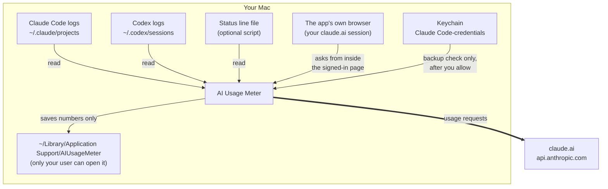
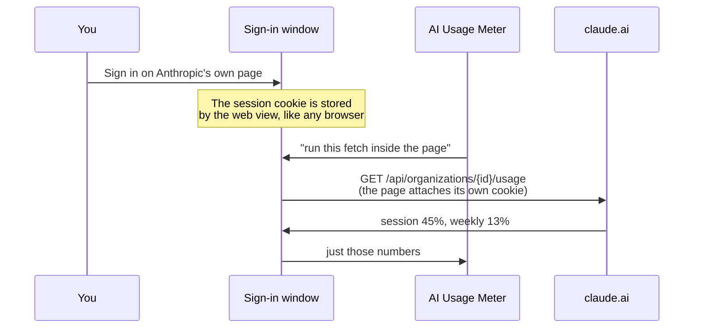
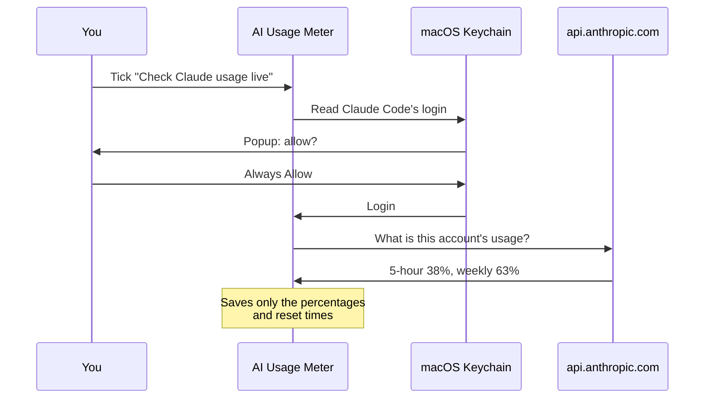

# Security

This app is close to private stuff: your AI chat logs, a signed-in claude.ai
session, and (for the backup check) your Claude Code login. This page explains what it touches, why, and
how it keeps things safe. It also lists what it **can't** promise.

---

## Found a security problem?

Please **don't** open a public issue.

Use GitHub's private reporting instead: on the repository page, go to
**Security → Report a vulnerability**. Include what you found and how to reproduce
it. Please give reasonable time for a fix before sharing it publicly.

> Maintainer note: private reporting has to be switched on first, under
> **Settings → Code security → Private vulnerability reporting**. See
> [docs/OPEN-SOURCE-CHECKLIST.md](docs/OPEN-SOURCE-CHECKLIST.md).

---

## What the app touches



| Thing | What the app does | When |
|---|---|---|
| Codex logs `~/.codex/sessions` | Reads | Always |
| Claude Code logs `~/.claude/projects` | Reads | Always |
| `https://claude.ai/api/organizations…` | Sends a request from inside the signed-in page | About once a minute, once you sign in |
| The claude.ai session cookie | **Never reads it.** It stays in the app's browser storage, which attaches it automatically | — |
| Keychain item `Claude Code-credentials` | Reads | Backup check only: when **Check Claude usage live** is on and you click Allow |
| `https://api.anthropic.com/api/oauth/usage` | Sends a request | Backup check only: when you open the panel, every 30 min, and on ⟳ — at most once per 10 min |
| `~/Library/Application Support/AIUsageMeter/` | Reads and writes | Always. Folder mode `0700`. Holds the cache, reading files and `instance.lock` |
| `~/Library/Caches/local.aiusagemeter/` | **Deletes** | At launch, if present. It's the request cache left by early builds (see Past issues) |

### What the app never does

- ❌ See your password: you type it on Anthropic's own page
- ❌ Read, copy or store the claude.ai session cookie
- ❌ Read cookies from Safari, Chrome or any other browser
- ❌ Open your OpenAI login (`~/.codex/auth.json`)
- ❌ Contact any website except `claude.ai` and `api.anthropic.com`
- ❌ Run commands or start other programs
- ❌ Send analytics, tracking or crash reports
- ❌ Change Claude Code's or Codex's own files
- ❌ Save your chats, prompts or code

You can check the network part yourself while the app runs:

```bash
lsof -nP -a -p "$(pgrep -f 'AI Usage Meter.app/Contents/MacOS')" -i
```

(Keep `-a`. Without it, `lsof` also lists other apps' connections.)

---

## Signing in to claude.ai

The app shows Anthropic's own sign-in page in a window it owns (a `WKWebView`),
and afterwards asks claude.ai for your usage.



Why it is built this way:

1. **The app never handles the cookie.** The request runs *inside* the page with
   `fetch()`, so the web view attaches its own cookie. Other apps of this kind
   read the cookie out of Safari's or Chrome's cookie database; this one never
   touches another app's storage.
2. **Your password never reaches the app.** It is typed on Anthropic's page.
3. **Only numbers come back** — the percentages and reset times.
4. **Signing out inside the window removes the session**, as does deleting
   `~/Library/Application Support/AIUsageMeter/`.

### What to be aware of

- **A signed-in session is sensitive.** Anyone who can run programs as your Mac
  user could use the app's browser storage, exactly as they could use Safari's.
- **Check the address before typing a password.** The window shows a real web
  page; it should be Anthropic's. This app only ever loads `claude.ai` there.
- **"Continue with Google" will not work.** Google blocks sign-in inside embedded
  windows.
- **These website endpoints are not a published API**, so they may change.

---

## The backup check (api.anthropic.com)

This is the most sensitive part, so here is exactly what happens.



The rules in the code (`ClaudeLiveUsage.swift`):

1. **Off by default.** Nothing reads the login until you turn the setting on.
2. **You approve.** macOS asks before the app can read the login. If you click
   Deny, the app pauses live checks instead of asking again every 5 minutes.
3. **Not saved on purpose.** The login is read for each check, sent with that one
   request, and never intentionally written to a file, logged, or shown in an
   error. *Limitation:* Swift gives no control over when that memory is cleared,
   so it may stay in the app's memory for a while.
4. **Nothing cached.** Requests use a private ("ephemeral") mode with the disk
   cache, cookies and saved credentials turned off.
5. **No redirects.** If a server replies "go somewhere else", the app refuses, so
   the login can't be forwarded to another site.
6. **One fixed address.** The login only ever goes to
   `https://api.anthropic.com/api/oauth/usage`, written directly in the code.
7. **Numbers only.** From the reply, only percentages and reset times are kept.

### ⚠️ This login can do more than read usage

It's Claude Code's own login, not a special read-only key. That's why the rules
above are strict, and why the setting is off until you choose it.

---

## Your chats

The log files contain your conversations:

1. The app scans each line for a keyword like `"usage"` or `rate_limits`.
2. Lines without it are skipped.
3. Lines with it are decoded in memory, which briefly includes that message's
   text. The numbers are copied out and the rest is dropped.

| Saved | Never saved |
|---|---|
| Token counts in 5-minute groups | Messages, prompts, answers |
| Log file paths and how far each was read | Code |
| Limit percentages, reset times, plan name | Logins |

File paths show your project folder names, which is why the app's folder is only
readable by your Mac user.

---

## Past issues

### ✅ Fixed: the Claude login was saved in a cache file

**Found:** in a security check before release, September 16, 2026.

**What happened:** an early build used macOS's default way of making web requests
(`URLSession.shared`). That default saves requests to a cache file,
`~/Library/Caches/local.aiusagemeter/Cache.db`, **including the login header**.
Only your Mac user could read it, but it shouldn't have been there.

**Fix:** the app now uses a private request mode that saves nothing. See rule 4
above. Current builds also **delete that old cache folder automatically at
launch**, without reading it. If deleting fails, the panel shows a message.

**To remove it by hand** (for example, if you won't run a newer build):

```bash
rm -rf ~/Library/Caches/local.aiusagemeter
```

For extra safety, run `/logout` and then `/login` in Claude Code to get a fresh
login. Logins also expire on their own.

---

## Risks that are still there

| Risk | What it means |
|---|---|
| Website endpoints are unofficial | claude.ai could change them. Numbers would stop updating; nothing becomes unsafe. |
| A signed-in session sits in the app's storage | Same exposure as being signed in to claude.ai in a browser on this Mac. Sign out in the window to remove it. |
| Login stays in memory | See rule 3. Anything able to read this app's memory already runs as you. |
| Not signed by Apple | Fine when you build it yourself. Downloads you share should be signed and notarized. |
| "Always Allow" persists | It's tied to that exact build. Each rebuild asks again. |
| Malware on your Mac | Anything running as your user can already read these files and ask for the same Keychain item. This app neither adds nor removes that risk. |

---

## Checklist before every release

- [ ] `grep -rn "URLSession.shared" Sources/` finds only the comment explaining why it's avoided
- [ ] `grep -rn "https://" Sources/` finds only `api.anthropic.com`
- [ ] Nothing logs the login or request headers: `grep -rn "print\|NSLog\|os_log" Sources/`
- [ ] No personal info or tokens:
      `grep -rnIE "sk-ant|Bearer [A-Za-z0-9]|/Users/[a-z]|@gmail" --exclude-dir=build --exclude-dir=.build --exclude=SECURITY.md .`
- [ ] With live check on, after launch and a refresh, `~/Library/Caches/local.aiusagemeter/` does **not** exist
- [ ] With live check off and no claude.ai sign-in, `lsof` (above) shows no connections
- [ ] The app never reads the cookie itself:
      `grep -rn "HTTPCookie\|cookieStore\|binarycookies" Sources/` finds nothing
- [ ] `debug.log` records events only — no cookies, tokens or page content
- [ ] `./scripts/run-tests.sh` passes
- [ ] `git status` shows no databases, `.jsonl` logs, `auth.json` or `build/` files
