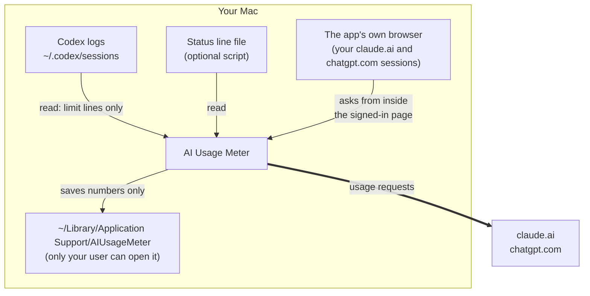
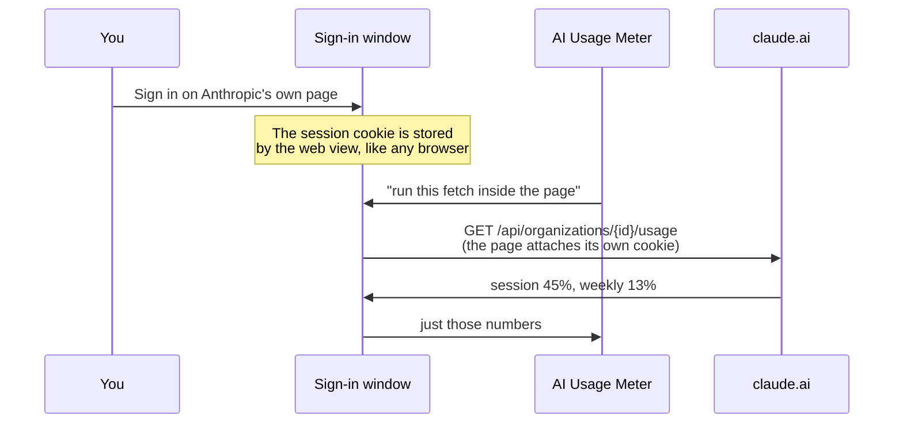

# Security

This app is close to private stuff: Codex's logs and signed-in claude.ai and
chatgpt.com sessions.
It does **not** read Claude Code's logs or your Claude Code login at all. This page explains what it touches, why, and
how it keeps things safe. It also lists what it **can't** promise.

---

## Found a security problem?

Please **don't** open a public issue.

Use GitHub's private reporting instead: on the repository page, go to
**Security → Report a vulnerability**. Include what you found and how to reproduce
it. Please give reasonable time for a fix before sharing it publicly.

> Maintainer note: private reporting has to be switched on first, under
> **Settings → Code security → Private vulnerability reporting**. See
> [docs/OPEN-SOURCE-CHECKLIST.md](docs/OPEN-SOURCE-CHECKLIST.md).

---

## What the app touches



| Thing | What the app does | When |
|---|---|---|
| Codex logs `~/.codex/sessions` | Reads lines carrying `rate_limits` | Always |
| Claude Code logs `~/.claude/projects` | **Never opened** | — |
| `https://claude.ai/api/organizations…` | Sends a request from inside the signed-in page | About once a minute, only after you click **Sign in** for Claude |
| `https://chatgpt.com/api/auth/session`, `/backend-api/wham/usage` | Sends requests from inside the signed-in page | About once a minute, only after you click **Sign in** for ChatGPT |
| Session cookies for both sites | **Never reads them.** They stay in the app's browser storage, which attaches them automatically | — |
| chatgpt.com's short-lived access token | Used **inside the page only**, the same way chatgpt.com's own pages use it. Never returned to the app, saved or logged | Each ChatGPT usage check |
| Keychain (including `Claude Code-credentials`) | **Never opened.** macOS never shows a Keychain prompt for this app | — |
| `~/Library/Application Support/AIUsageMeter/` | Reads and writes | Always. Folder mode `0700`. Holds the cache, reading files and `instance.lock` |
| `~/Library/Caches/local.aiusagemeter/` | **Deletes** | At launch, if present. It's the request cache left by early builds (see Past issues) |
| `statusline/claude-live.json` | **Deletes** | At launch, if present. Left by earlier builds' removed backup check |

### What the app never does

- ❌ See your password: you type it on the provider's own page
- ❌ Read, copy or store a session cookie or access token
- ❌ Read cookies from Safari, Chrome or any other browser
- ❌ Open your OpenAI login (`~/.codex/auth.json`)
- ❌ Read anything from the Keychain
- ❌ Contact any website except `claude.ai` and `chatgpt.com`, and those only after you sign in
- ❌ Run commands or start other programs
- ❌ Send analytics, tracking or crash reports
- ❌ Change Claude Code's or Codex's own files
- ❌ Save your chats, prompts or code

You can check the network part yourself while the app runs:

```bash
lsof -nP -a -p "$(pgrep -f 'AI Usage Meter.app/Contents/MacOS')" -i
```

(Keep `-a`. Without it, `lsof` also lists other apps' connections.)

---

## Signing in to claude.ai and chatgpt.com

The app shows each provider's own sign-in page in a window it owns (a
`WKWebView`), and afterwards asks that site for your usage. claude.ai is shown
below; chatgpt.com works the same way.



Why it is built this way:

1. **The app never handles the cookie.** The request runs *inside* the page with
   `fetch()`, so the web view attaches its own cookie. Other apps of this kind
   read the cookie out of Safari's or Chrome's cookie database; this one never
   touches another app's storage.
2. **Your password never reaches the app.** It is typed on the provider's own page.
3. **Only numbers come back** — the percentages and reset times. chatgpt.com's
   usage call needs a bearer token, which the site hands to its own pages at
   `/api/auth/session`. The script fetches it and uses it *inside the page*, then
   returns only the usage reply, so the token never reaches the app.
4. **Signing out inside the window removes the session**, as does deleting
   `~/Library/Application Support/AIUsageMeter/`.

### What to be aware of

- **A signed-in session is sensitive.** Anyone who can run programs as your Mac
  user could use the app's browser storage, exactly as they could use Safari's.
- **Check the address before typing a password.** The window shows a real web
  page; it should be the provider's. This app only ever loads `claude.ai` and
  `chatgpt.com` there.
- **"Continue with Google" will not work.** Google blocks sign-in inside embedded
  windows.
- **These website endpoints are not a published API**, so they may change.

---

## Your chats

**Claude Code's logs are never opened.** The app doesn't count tokens, so it has
no reason to read them.

Codex's logs do hold your Codex conversations, and the app reads them like this:

1. Each line is scanned for the bytes `rate_limits`.
2. Lines without it are skipped without being decoded.
3. A line with it is decoded in memory, the limit numbers are copied out, and the
   rest is dropped.

| Saved | Never saved |
|---|---|
| Limit percentages, reset times, plan name | Messages, prompts, answers |
| Codex log paths and how far each was read | Code, token counts |
| | Logins and cookies |

File paths show your project folder names, which is why the app's folder is only
readable by your Mac user.

---

## Past issues

### ✅ Fixed: the Claude login was saved in a cache file

**Found:** in a security check before release, September 16, 2026.

**What happened:** an early build used macOS's default way of making web requests
(`URLSession.shared`). That default saves requests to a cache file,
`~/Library/Caches/local.aiusagemeter/Cache.db`, **including the login header**.
Only your Mac user could read it, but it shouldn't have been there.

**Fix:** that login-based check was later removed entirely; the app no longer
reads the Claude Code login at all. Current builds also **delete that old cache folder automatically at
launch**, without reading it. If deleting fails, the panel shows a message.

**To remove it by hand** (for example, if you won't run a newer build):

```bash
rm -rf ~/Library/Caches/local.aiusagemeter
```

For extra safety, run `/logout` and then `/login` in Claude Code to get a fresh
login. Logins also expire on their own.

---

## Risks that are still there

| Risk | What it means |
|---|---|
| Website endpoints are unofficial | claude.ai or chatgpt.com could change them. Numbers would stop updating; nothing becomes unsafe. |
| A signed-in session sits in the app's storage | Same exposure as being signed in to those sites in a browser on this Mac. Sign out in the window to remove it. |
| Not signed by Apple | Fine when you build it yourself. Downloads you share should be signed and notarized. |
| Malware on your Mac | Anything running as your user can already read these files and your browser sessions. This app neither adds nor removes that risk. |

---

## Checklist before every release

- [ ] `grep -rn "https://" Sources/` finds only `claude.ai` and `chatgpt.com`
- [ ] Nothing logs cookies or request headers: `grep -rn "print\|NSLog\|os_log" Sources/`
- [ ] No personal info or tokens:
      `grep -rnIE "sk-ant|Bearer [A-Za-z0-9]|/Users/[a-z]|@gmail" --exclude-dir=build --exclude-dir=.build --exclude=SECURITY.md .`
- [ ] After launch and a refresh, `~/Library/Caches/local.aiusagemeter/` does **not** exist
- [ ] On a fresh install, before clicking any **Sign in**, `lsof` (above) shows no connections
- [ ] No Keychain access: `grep -rn "SecItem\|import Security" Sources/` finds nothing
- [ ] The app never reads the cookie itself:
      `grep -rn "HTTPCookie\|cookieStore\|binarycookies" Sources/` finds nothing
- [ ] `debug.log` records events only — no cookies, tokens or page content
- [ ] `./scripts/run-tests.sh` passes
- [ ] `git status` shows no databases, `.jsonl` logs, `auth.json` or `build/` files
