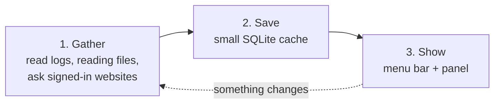
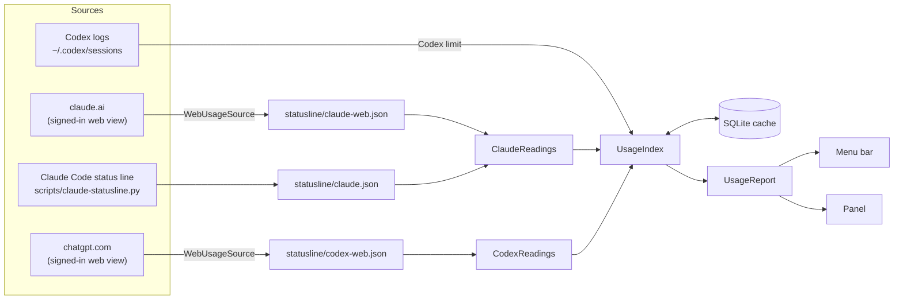
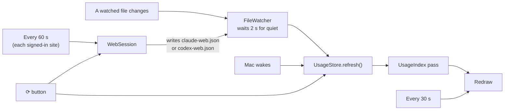
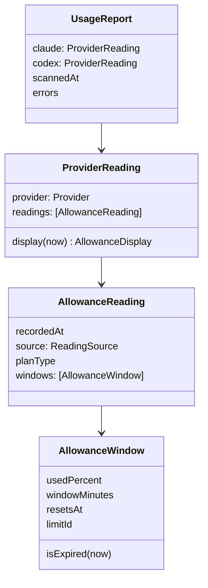
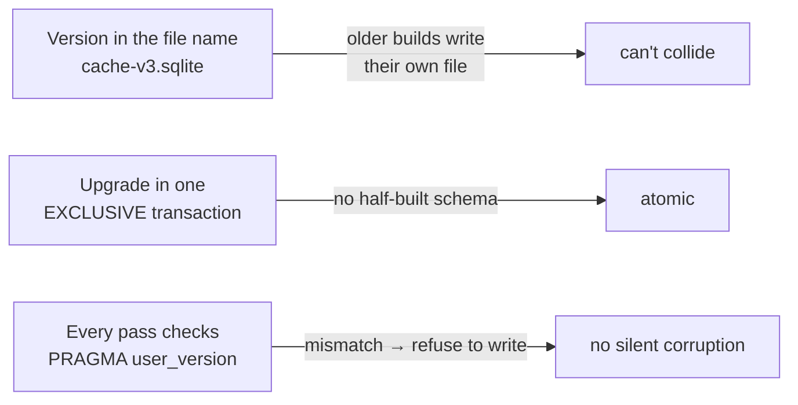
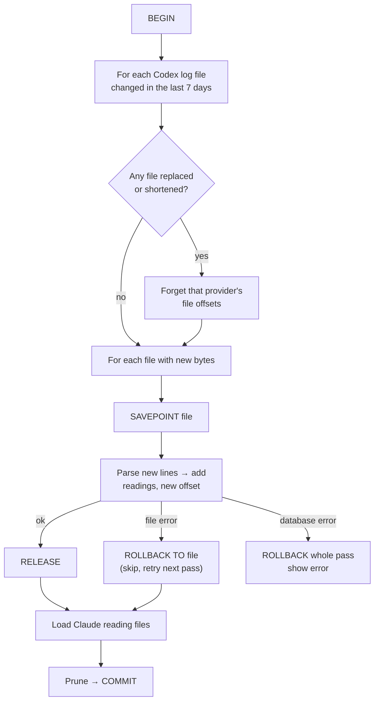

# Architecture

How the app is built. Simple picture first, details after.

## The big picture

The app repeats 3 steps:

## Where each number comes from

## What triggers an update

The 30-second redraw doesn't rescan anything. It recomputes "… ago" text,
countdowns **and expiry**, so a limit that resets while the app is open changes
to `?` without waiting for new data.

---

## Rules the design follows

1. **Never invent a limit.** A percentage appears only if Anthropic or OpenAI
   reported it. The app counts no tokens and computes no percentages.
2. **Readings are snapshots.** Every reading keeps when it was recorded and where
   it came from.
3. **Expired isn't zero.** Expiry is checked at display time against the current
   clock. A reset window is hidden. If every window has reset, the provider shows
   "unknown" (`?`).
4. **Read only what's new.** Logs run to hundreds of MB. After the first pass,
   only appended bytes are read.
5. **Readings and offsets move together.** Readings and "how far each file was
   read" are saved in the same transaction, or not at all.
6. **Nothing online unless asked.** The only network use is the signed-in
   website pages you chose to sign in to. The Keychain is never read.
7. **Keep accounts separate.** Each added account has its own persistent WebKit
   browser store and usage file. The original two accounts keep their existing
   browser store and reading files after an upgrade, and also use the backups
   (Codex's logs, the status line); the freshest reading wins. Any account can
   be signed out or removed; a removed account's browser store is deleted, and
   any left behind (WebKit refuses while a page uses it) goes at the next launch.

---

## Source files

| File | Job |
|---|---|
| `main.swift` | Entry point. `--scan` prints results; otherwise `AppController` runs the menu bar item and popover |
| `UsageStore.swift` | Main-actor state: schedules index passes, watchers, timers, website checks; settings; menu bar text |
| `AccountRegistry.swift` | Saves account names and pin choices; assigns stable IDs for separate browser stores |
| `UsageIndex.swift` | One index pass: ingest (transaction) → build `UsageReport` |
| `Database.swift` | SQLite wrapper and schema. All writes throw on failure |
| `LogParser.swift` | Protocol shared by the log parsers |
| `CodexParser.swift` | Codex logs → limit readings (all windows, with `limit_id`) |
| `ClaudeReadings.swift` | Loads the Claude reading files; decides which one to show |
| `CodexReadings.swift` | Loads the chatgpt.com reading file |
| `WebSession.swift` | The app's own browser, one per account: sign-in window, and usage calls made *inside* the signed-in page |
| `WebUsageSource.swift` | Turns either site's reply into a reading file (`claude-web.json`, `codex-web.json`) |
| `LineReader.swift` | Streaming line reader, byte keyword search, JSON helpers, file discovery |
| `InstanceLock.swift` | One running copy at a time; `--rebuild` can't run under the app |
| `LegacyCleanup.swift` | Removes files earlier builds left behind (request cache, `claude-live.json`) |
| `FileWatcher.swift` | FSEvents wrapper with a 2-second debounce |
| `Models.swift` | Data types, display decisions, formatting |
| `UsagePanel.swift` | SwiftUI panel and provider cards |
| `ProviderIcons.swift` | Loads the logo SVGs; draws the menu bar label, colouring each percentage by `UsageBand` |

Other code:

| Path | Job |
|---|---|
| `scripts/claude-statusline.py` | Optional Claude Code status line that writes `claude.json` |
| `Tests/main.swift` | Regression tests (synthetic data), run by `scripts/run-tests.sh` |
| `tools/screenshots/` | Renders README screenshots from made-up data |
| `tools/svg2png/` | Renders `assets/app-icon.svg` for `scripts/make-app-icon.sh` |

---

## Data model

**`ReadingSource`**: `claudeWeb`, `chatgptWeb`, `claudeStatusLine`, `codexLog`.
The UI describes each one differently ("From claude.ai", "From chatgpt.com", "From
Claude Code status line · received", "From Codex logs · recorded").

**`ProviderReading.display(now:)`** returns:
- `.available(headline, others, reading)`: at least one window still valid
- `.expired(reading)`: a reading exists, but every window has reset
- `.unavailable`: no reading

**Which readings are candidates:** the newest reading for each source **and each
limit id**. For Codex, every candidate's valid windows are pooled, so a newer
reading for one limit can't hide another. For Claude, one reading is chosen at
display time by `ClaudeReadings.choose`.

**Usage colour** (`ProviderIcons.UsageBand`), shared by the menu bar and panel,
from the rounded percentage: under 25% plain, 25–49% yellow, 50–79% orange,
80%+ red.

**Menu bar appearance** is per account (`Account.menuValue` / `menuLabel`,
saved in `accounts.json`, nil meaning the default). `UsageStore.menuBarFigure`
turns a reading into the value text for the chosen `MenuBarValue`; All limits
joins every valid window, shortest first, so it adapts to whatever limits the
account has. `ProviderIcons.attributed` colours each `N%` by its own band.

**Headline window** (`Provider.headline`):
- Claude: the 5-hour window if it's still valid, otherwise the shortest valid one.
- Codex: the valid window closest to its limit, since that's the one that would
  stop work.

---

## Claude: two sources, one choice

### Why two

claude.ai's own endpoints are the ones the website polls itself, so they can be
asked every minute. That is the normal source; the status line is the backup for
people who don't sign in. (Earlier builds also read Claude Code's Keychain login
to ask `api.anthropic.com/api/oauth/usage`, which is rate-limited hard. That was
removed, and a leftover `claude-live.json` is deleted at launch.)

Each source has its own file, so none can overwrite another:

| File | Written by | Timestamp means |
|---|---|---|
| `statusline/claude-web.json` | `WebUsageSource` | When the app asked claude.ai |
| `statusline/claude.json` | `claude-statusline.py` | When the script *received* it from Claude Code |

`ClaudeReadings.choose` picks, **each time the screen is drawn**:
1. The newest **claude.ai** reading under **15 minutes** old with a valid window.
   It is preferred because it can be asked every minute.
2. Otherwise, the newest reading of any source that still has a valid window.
3. Otherwise, the newest reading, shown as "unknown".

Validity comes first, so a reading that has reset can never hide a usable one.

Both files sit in `statusline/`, which is its own watched folder. Watching the
parent folder would also catch the app's own SQLite writes and loop forever.

---

## Storage

`~/Library/Application Support/AIUsageMeter/cache-v3.sqlite`: WAL mode, 30 s busy
timeout, folder mode `0700`.

**Schema versions are protected three ways.** An older build running alongside a
newer one once corrupted the cache (it doubled what was then a token count), so:

A cache from a *newer* schema is never dropped. The app shows an error instead.

**One copy at a time.** `InstanceLock` takes an exclusive `flock` on
`instance.lock` for the app's whole life. A second copy shows "already running"
and quits. `--scan --rebuild` needs the same lock, so it refuses to delete the
cache while the app runs. A plain `--scan` doesn't take the lock: its writes are
transactions, and the pass opens its transaction *before* reading file offsets, so
two passes can't both read the same bytes.

| Table | Key | Holds |
|---|---|---|
| `files` | `path` | `provider`, `inode`, `offset` (bytes read), `mtime` |
| `readings` | `(provider, source, limit_key, recorded_at)` | Plan and the windows for that limit, as JSON |

Pruning: readings older than 30 days. There is no token table: the app counts
nothing, which is also why Claude Code's logs are never read.

### One index pass

Why each piece exists:
- **Savepoint per file:** a read error halfway through a file must not leave its
  readings saved with an offset that says the file was fully read.
- **Rollback on any database error:** readings and offsets must never disagree.
- **Replaced or shortened file:** the stored offsets are meaningless, so that
  provider's logs are read again. Readings already saved are keyed by when they
  were taken, so re-reading can only re-add the same rows.

### Line reading details (`LineReader`)

- Reads in 1 MB chunks, draining memory per chunk and per line.
- A half-written last line is neither delivered nor counted in the offset, since
  the CLI may still be writing it.
- Lines over 64 MB are skipped, whether they end inside the current buffer or
  span many chunks. Their bytes **are** counted in the offset once their newline
  arrives, so the next pass resumes after them. If the file ends before that
  newline, the offset stops before the line.

---

## UI

- **AppKit shell:** `NSStatusItem` + `NSPopover` hosting SwiftUI through
  `NSHostingController`.
- **No SwiftUI state macros:** the panel is a plain function of the values
  passed in, and `UsageStore.onChange` triggers redraws. See
  [CONTRIBUTING.md](../CONTRIBUTING.md#why-not-xcode-or-swift-build) for why.
- **Menu bar label is one image:** logos and text are drawn together, because
  logos placed inside attributed text disappeared on dark menu bars. It is *not* a
  template image (templates are one colour, and the percentages are coloured).
  Instead the drawing handler runs at display time under the menu bar's
  appearance, so `labelColor` resolves to white or black as needed.

---

## Build

`build-app.sh`:
1. `swiftc -O` every file in `Sources/AIUsageMeter/` for `arm64-apple-macosx14.0`.
   SQLite3 is linked automatically.
2. Assembles `build/AI Usage Meter.app`: binary, `Info.plist` (`LSUIElement`, bundle
   id `io.github.prajwalsr.aiusagemeter`), `AppIcon.icns`, the two logo SVGs.
3. Signs it ad hoc (`codesign --sign -`).
