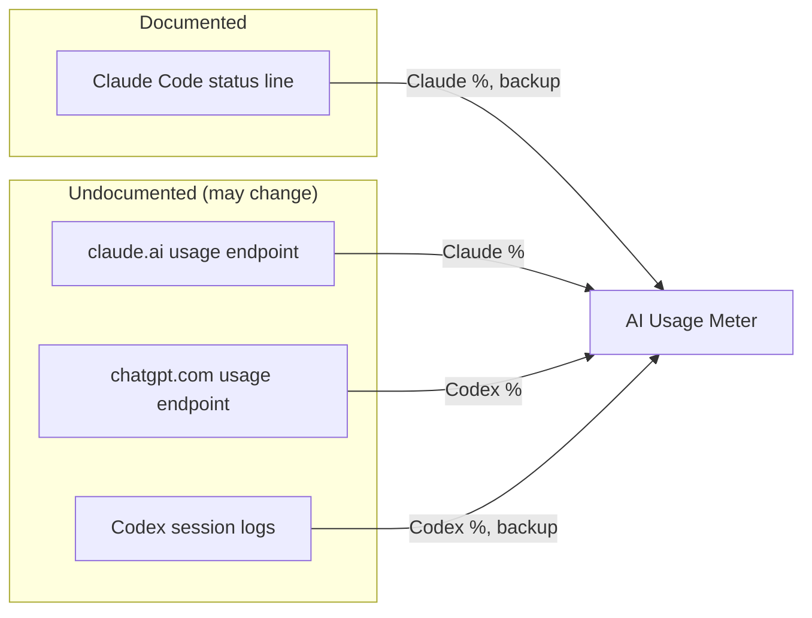

# Data sources

The exact files, fields and addresses the app depends on, and how much each can be
trusted. Check here first when numbers look wrong after a Claude Code, Codex,
claude.ai or chatgpt.com update.



| Source | Documented? | Needs a login | Network | Used for |
|---|---|---|---|---|
| claude.ai `/api/organizations/{id}/usage` | **No** | claude.ai sign-in, in the app's window | Yes | Claude % (the normal source) |
| Claude Code status line `rate_limits` | **Yes** | No | No | Claude %, backup |
| chatgpt.com `/backend-api/wham/usage` | **No** | chatgpt.com sign-in, in the app's window | Yes | Codex % (the normal source) |
| Codex session logs `rate_limits` | No, internal log format | No | No | Codex %, backup |

The app does **not** read Claude Code's session logs, count tokens, or read the
Keychain.

Observed with Claude Code 2.1.231–2.1.270 and Codex CLI logs from September 2026.

---

## claude.ai website endpoints (the normal Claude source)

Called from **inside** the app's signed-in page, so the web view attaches its own
cookie and the app never handles it:

```
GET https://claude.ai/api/organizations                  → organizations, pick the one with "chat"
GET https://claude.ai/api/organizations/{orgId}/usage    → the usage below
```

Real reply, keys and types only (values invented):

```json
{
  "five_hour":  { "utilization": 45, "resets_at": "2027-03-01T15:50:00.000000Z",
                  "limit_dollars": null, "used_dollars": null, "locked_reason": null },
  "seven_day":  { "utilization": 13, "resets_at": "2027-03-05T17:00:00.000000Z" },
  "seven_day_opus": null, "seven_day_sonnet": null, "seven_day_cowork": null,
  "nimbus_quill": { "utilization": 0, "resets_at": null },
  "extra_usage": { "is_enabled": false, "utilization": null },
  "limits": [ { "kind": "…", "group": "…" } ]
}
```

What the parser does with it (`WebUsageSource`):

- `utilization` is 0–100; `resets_at` is an ISO 8601 string (or null).
- **Only real windows are kept:** one the app can name (`five_hour`, `seven_day`)
  or one that says when it resets. The reply also carries internal entries with
  code names — `nimbus_quill`, `tangelo`, `iguana_necktie` — sitting at 0% with no
  window and no reset. They are not usage limits and are ignored.
- An unfamiliar entry *with* a reset time is kept under its own name, so a new
  limit shows up instead of disappearing.
- Names are matched loosely (`five`/`5h`/`session`, `seven`/`7d`/`week`), since
  these keys are not a published API.
- The raw reply is saved to `statusline/claude-web-raw.json` for inspection. It
  holds usage numbers and an organization id — never a cookie.

Sign-in notes: Google sign-in does not work inside an embedded window (Google
blocks it); use email. Events are logged to `statusline/debug.log` — events only,
never cookies or page content.

---

## chatgpt.com website endpoints (the normal Codex source)

Called from **inside** the app's signed-in page. The site's own pages get a
short-lived bearer token from `/api/auth/session` and send it to `/backend-api`;
the app's script does the same, inside the page, so the token never leaves it and
nothing is stored:

```
GET https://chatgpt.com/api/auth/session       → { "accessToken": "…" }  (stays in the page)
GET https://chatgpt.com/backend-api/wham/usage → the usage below
```

Relevant part of the reply, keys and types only (values invented):

```json
{
  "rate_limits": {
    "primary_window":   { "used_percent": 61, "limit_window_seconds": 604800,
                          "reset_after_seconds": 500000, "reset_at": 1800500000 },
    "secondary_window": { "used_percent": 12, "limit_window_seconds": 18000,
                          "reset_at": 1800000000 }
  }
}
```

What the parser does with it (`WebUsageSource`, same code as claude.ai):

- Windows are named by **rank** (`primary_window`, `secondary_window`), not by
  length, just like the Codex logs. The length comes from `limit_window_seconds`;
  the rank is never shown as a limit name.
- `reset_at` (epoch seconds) is preferred; `reset_after_seconds` (seconds from
  now) is the fallback.
- The raw reply is saved to `statusline/chatgpt-web-raw.json` and the reading to
  `statusline/codex-web.json`. Neither holds the token or a cookie.

### How the Codex sources are combined

Same rule as Claude: a chatgpt.com reading under 15 minutes old with a valid
window wins, even over a newer log line; otherwise the newest valid reading wins.
See `ReadingSelection.choose`.

## Removed: Anthropic usage endpoint

Earlier builds had an optional backup check that read Claude Code's login from the
Keychain and asked `api.anthropic.com/api/oauth/usage`. It was removed: claude.ai
covers the same need without Keychain access. A leftover
`statusline/claude-live.json` from those builds is deleted at launch
(`LegacyCleanup.removeLegacyLiveReading`).

## Claude Code status line

Documented at <https://code.claude.com/docs/en/statusline>. Claude Code runs the
configured command and sends session JSON on stdin. Relevant part:

```json
{
  "version": "2.1.231",
  "session_id": "…",
  "rate_limits": {
    "five_hour": { "used_percentage": 23.5, "resets_at": 1738425600 },
    "seven_day": { "used_percentage": 41.2, "resets_at": 1738857600 }
  }
}
```

Documented behavior this app relies on:

- `rate_limits` is present **only for claude.ai Pro and Max subscribers**, and
  only **after the first API response** in a session.
- Each window may be absent on its own.
- Claude Code **drops a window once its `resets_at` passes**.
- `resets_at` is Unix epoch seconds.

Observed: the status line runs **only in the interactive terminal UI**. Desktop
app and IDE sessions run Claude Code headless and never invoke it. A
pseudo-terminal with zero rows or columns also draws nothing.

`scripts/claude-statusline.py` writes two files in
`~/Library/Application Support/AIUsageMeter/statusline/`:

- `claude.json`, with `received_at` and `rate_limits` (`five_hour` / `seven_day`, each `used_percentage` and `resets_at`). `received_at` is when
  the script received the figure, not when Anthropic produced it. It's only
  written when `rate_limits` is present, so a good reading is never replaced by an
  empty one.
- `last-invoked.json`, written on every run, with or without `rate_limits`. It
  tells "never invoked" apart from "invoked without usage data".

Files from older builds used `recorded_at` instead of `received_at`; they still load.

### How the Claude sources are combined

Only readings that still have a valid (not yet reset) window can win. Among those,
claude.ai wins if it is under 15 minutes old, then whichever is newest. If none is valid, the newest is shown as
"unknown". This is decided each time the screen is drawn, so a reading that goes
stale stops winning without a rescan. See `ClaudeReadings.choose` and
[ARCHITECTURE.md](ARCHITECTURE.md#claude-two-sources-one-choice).

## Codex session logs

Location: `~/.codex/sessions/YYYY/MM/DD/rollout-<timestamp>-<id>.jsonl`, one JSON
object per line.

### Rate limits

On `event_msg` lines whose `payload.type` is `token_count`:

```json
{
  "timestamp": "2026-09-16T15:00:32.185Z",
  "type": "event_msg",
  "payload": {
    "type": "token_count",
    "info": { "…": "…" },
    "rate_limits": {
      "limit_id": "codex",
      "primary":   { "used_percent": 54.0, "window_minutes": 10080, "resets_at": 1789824395 },
      "secondary": null,
      "credits":   { "has_credits": false, "unlimited": false, "balance": "0" },
      "plan_type": "prolite"
    }
  }
}
```

Pitfalls seen in real data:

- **`primary` isn't always the short window.** It has been observed as a 7-day
  (`10080`) window with `secondary: null`. Always read `window_minutes`; never
  infer the duration from the key.
- **`plan_type` changes over time** for the same account (`plus` and later
  `prolite`). It reflects the plan when the line was written.
- The line's top-level `timestamp` is the reading's `recordedAt`.
- **Every window is kept**, each tagged with the block's `limit_id`. The cache
  stores the newest reading **per limit id**, so a newer reading for one limit
  never hides another limit that is still valid. The card's big number is the
  valid window closest to its limit, across all limits. If `limit_id` is anything
  other than `codex`, it's shown next to the window name.
- `window_minutes` is read as a number of any type (integer or floating point).

Known `plan_type` values and display names (`UsagePanel.planLabel`):

| `plan_type` | Shown as |
|---|---|
| `prolite` | Pro 5x |
| `pro` | Pro |
| `plus` | Plus |
| `team` | Team |
| other | raw value |

## When a format changes

1. Run `./build/AIUsageMeter --scan` and see which provider or field is wrong.
2. Look at the **structure** of a recent line: key names and value types, never
   the values. These files hold your conversations, so don't paste real content
   anywhere:
   ```bash
   f=$(ls -t ~/.codex/sessions/*/*/*/*.jsonl | head -1)
   grep -m1 rate_limits "$f" | python3 -c '
   import json, sys
   def shape(v):
       if isinstance(v, dict): return {k: shape(x) for k, x in v.items()}
       if isinstance(v, list): return [shape(v[0])] if v else []
       return type(v).__name__
   print(json.dumps(shape(json.load(sys.stdin)["payload"]["rate_limits"]), indent=1))'
   ```
   It prints something like `"used_percent": "float"`, with no actual numbers.
3. Update the parser and this document together.
