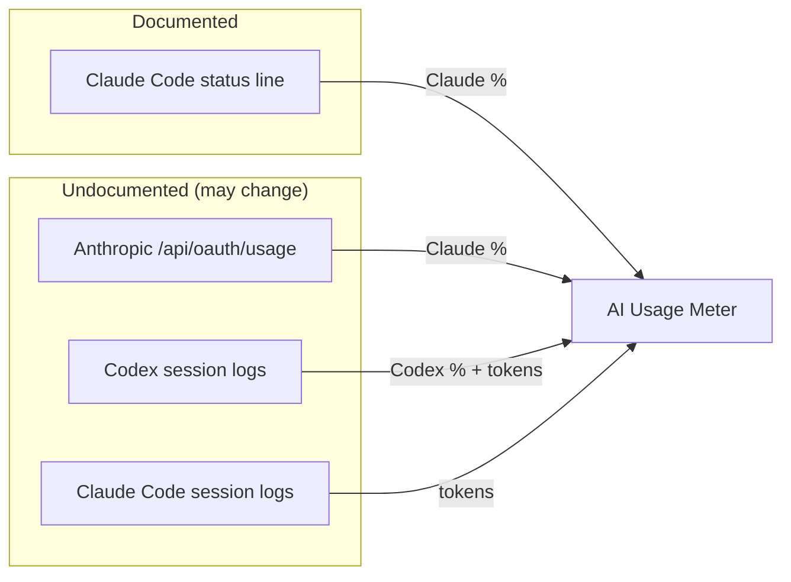

# Data sources

The exact files, fields and address the app depends on, and how much each can be
trusted. Check here first when numbers look wrong after a Claude Code, Codex or
Anthropic update.



| Source | Documented? | Needs a login | Network | Used for |
|---|---|---|---|---|
| claude.ai `/api/organizations/{id}/usage` | **No** | claude.ai sign-in, in the app's window | Yes | Claude % (the normal source) |
| Anthropic `/api/oauth/usage` | **No** | Claude Code login | Yes | Claude %, backup |
| Claude Code status line `rate_limits` | **Yes** | No | No | Claude %, optional |
| Codex session logs `rate_limits` | No, internal log format | No | No | Codex % |
| Codex session logs `token_usage_record` | No, internal log format | No | No | Codex tokens |
| Claude Code session logs `usage` | No, internal log format | No | No | Claude Code tokens |

Observed with Claude Code 2.1.231–2.1.270 and Codex CLI logs from September 2026.

---

## claude.ai website endpoints (the normal Claude source)

Called from **inside** the app's signed-in page, so the web view attaches its own
cookie and the app never handles it:

```
GET https://claude.ai/api/organizations                  → organizations, pick the one with "chat"
GET https://claude.ai/api/organizations/{orgId}/usage    → the usage below
```

Real reply, keys and types only (values invented):

```json
{
  "five_hour":  { "utilization": 45, "resets_at": "2027-03-01T15:50:00.000000Z",
                  "limit_dollars": null, "used_dollars": null, "locked_reason": null },
  "seven_day":  { "utilization": 13, "resets_at": "2027-03-05T17:00:00.000000Z" },
  "seven_day_opus": null, "seven_day_sonnet": null, "seven_day_cowork": null,
  "nimbus_quill": { "utilization": 0, "resets_at": null },
  "extra_usage": { "is_enabled": false, "utilization": null },
  "limits": [ { "kind": "…", "group": "…" } ]
}
```

What the parser does with it (`ClaudeWebSource`):

- `utilization` is 0–100; `resets_at` is an ISO 8601 string (or null).
- **Only real windows are kept:** one the app can name (`five_hour`, `seven_day`)
  or one that says when it resets. The reply also carries internal entries with
  code names — `nimbus_quill`, `tangelo`, `iguana_necktie` — sitting at 0% with no
  window and no reset. They are not usage limits and are ignored.
- An unfamiliar entry *with* a reset time is kept under its own name, so a new
  limit shows up instead of disappearing.
- Names are matched loosely (`five`/`5h`/`session`, `seven`/`7d`/`week`), since
  these keys are not a published API.
- The raw reply is saved to `statusline/claude-web-raw.json` for inspection. It
  holds usage numbers and an organization id — never a cookie.

Sign-in notes: Google sign-in does not work inside an embedded window (Google
blocks it); use email. Events are logged to `statusline/debug.log` — events only,
never cookies or page content.

---

## Anthropic usage endpoint (backup)

Only used when **Check Claude usage live** is on.

**It is rate-limited.** Asking every 5 minutes tripped it; the server then replied
`{"error":{"type":"rate_limit_error"}}` with `Retry-After: 2493`. The app sends a
`User-Agent` naming itself, asks at most once every 10 minutes, and waits exactly
as long as `Retry-After` says (or 15 → 30 → 60 minutes when no header is sent).
Check it by hand with `./build/AIUsageMeter --check-claude`, which prints the
status, rate-limit headers and the server's error text, never the login.

```
GET https://api.anthropic.com/api/oauth/usage
Authorization: Bearer <claudeAiOauth.accessToken>
anthropic-beta: oauth-2025-04-20
```

**Credential:** macOS Keychain generic password, service `Claude Code-credentials`.
Its data is JSON:

```json
{ "claudeAiOauth": { "accessToken": "…", "refreshToken": "…", "expiresAt": 0, "…": "…" } }
```

Only `accessToken` is used. The app never refreshes the token; Claude Code does.

**Response fields used:**

```json
{
  "five_hour": { "utilization": 38.0, "resets_at": "2026-09-16T19:40:00.000000+00:00" },
  "seven_day": { "utilization": 63.0, "resets_at": "2026-09-17T21:00:00.000000+00:00" }
}
```

- `utilization` is 0–100.
- `resets_at` is ISO 8601, possibly with microseconds, which
  `ISO8601DateFormatter` rejects. The parser strips the fraction as a fallback.
  Epoch numbers are also accepted.
- Other keys may appear and are ignored.

**Failure mapping** (`ClaudeLiveUsage.Failure`):

| Situation | Case | What happens |
|---|---|---|
| No Keychain item | `noCredential` | Message asks you to log in to Claude Code |
| You clicked Deny | `accessDeclined` | Live checks pause until ⟳ or the setting is toggled |
| Item isn't the expected JSON | `badCredential` | Message shown |
| HTTP 401 | `http(401)` | "login expired" |
| Other HTTP status, network error, unexpected reply | `http` / `network` / `badResponse` | Message shown |

**Saved to** `~/Library/Application Support/AIUsageMeter/statusline/claude-live.json`:

```json
{ "received_at": 1789580000.0,
  "rate_limits": { "five_hour": { "used_percentage": 38, "resets_at": 1789590000 },
                   "seven_day": { "used_percentage": 63, "resets_at": 1789750000 } } }
```

## Claude Code status line

Documented at <https://code.claude.com/docs/en/statusline>. Claude Code runs the
configured command and sends session JSON on stdin. Relevant part:

```json
{
  "version": "2.1.231",
  "session_id": "…",
  "rate_limits": {
    "five_hour": { "used_percentage": 23.5, "resets_at": 1738425600 },
    "seven_day": { "used_percentage": 41.2, "resets_at": 1738857600 }
  }
}
```

Documented behavior this app relies on:

- `rate_limits` is present **only for claude.ai Pro and Max subscribers**, and
  only **after the first API response** in a session.
- Each window may be absent on its own.
- Claude Code **drops a window once its `resets_at` passes**.
- `resets_at` is Unix epoch seconds.

Observed: the status line runs **only in the interactive terminal UI**. Desktop
app and IDE sessions run Claude Code headless and never invoke it. A
pseudo-terminal with zero rows or columns also draws nothing.

`scripts/claude-statusline.py` writes two files in
`~/Library/Application Support/AIUsageMeter/statusline/`:

- `claude.json`, same shape as `claude-live.json` above. `received_at` is when
  the script received the figure, not when Anthropic produced it. It's only
  written when `rate_limits` is present, so a good reading is never replaced by an
  empty one.
- `last-invoked.json`, written on every run, with or without `rate_limits`. It
  tells "never invoked" apart from "invoked without usage data".

Files from older builds used `recorded_at`, and live readings were marked
`"source": "anthropic-usage-endpoint"` inside `claude.json`. Both still load.

### How the three Claude sources are combined

Only readings that still have a valid (not yet reset) window can win. Among those,
claude.ai wins if it is under 15 minutes old, then api.anthropic.com under 15
minutes, then whichever is newest. If none is valid, the newest is shown as
"unknown". This is decided each time the screen is drawn, so a reading that goes
stale stops winning without a rescan. See `ClaudeReadings.choose` and
[ARCHITECTURE.md](ARCHITECTURE.md#claude-two-sources-one-choice).

## Codex session logs

Location: `~/.codex/sessions/YYYY/MM/DD/rollout-<timestamp>-<id>.jsonl`, one JSON
object per line.

### Rate limits

On `event_msg` lines whose `payload.type` is `token_count`:

```json
{
  "timestamp": "2026-09-16T15:00:32.185Z",
  "type": "event_msg",
  "payload": {
    "type": "token_count",
    "info": { "…": "…" },
    "rate_limits": {
      "limit_id": "codex",
      "primary":   { "used_percent": 54.0, "window_minutes": 10080, "resets_at": 1789824395 },
      "secondary": null,
      "credits":   { "has_credits": false, "unlimited": false, "balance": "0" },
      "plan_type": "prolite"
    }
  }
}
```

Pitfalls seen in real data:

- **`primary` isn't always the short window.** It has been observed as a 7-day
  (`10080`) window with `secondary: null`. Always read `window_minutes`; never
  infer the duration from the key.
- **`plan_type` changes over time** for the same account (`plus` and later
  `prolite`). It reflects the plan when the line was written.
- The line's top-level `timestamp` is the reading's `recordedAt`.
- **Every window is kept**, each tagged with the block's `limit_id`. The cache
  stores the newest reading **per limit id**, so a newer reading for one limit
  never hides another limit that is still valid. The card's big number is the
  valid window closest to its limit, across all limits. If `limit_id` is anything
  other than `codex`, it's shown next to the window name.
- `window_minutes` is read as a number of any type (integer or floating point).

Known `plan_type` values and display names (`UsagePanel.planLabel`):

| `plan_type` | Shown as |
|---|---|
| `prolite` | Pro 5x |
| `pro` | Pro |
| `plus` | Plus |
| `team` | Team |
| other | raw value |

### Tokens

```json
{
  "timestamp": "2026-09-13T18:58:23.280Z",
  "type": "token_usage_record",
  "payload": {
    "usage": {
      "input_tokens": 30899,
      "cached_input_tokens": 19456,
      "cache_write_input_tokens": 0,
      "output_tokens": 260,
      "reasoning_output_tokens": 0,
      "total_tokens": 31159
    }
  }
}
```

`input_tokens` **includes** `cached_input_tokens`, so the parser stores
`input - cached` as input and `cached` as cache-read to avoid double counting.

## Claude Code session logs

Location: `~/.claude/projects/<escaped-project-path>/<session-id>.jsonl`.

Assistant lines carry usage:

```json
{
  "type": "assistant",
  "timestamp": "2026-09-15T21:49:05.961Z",
  "message": {
    "model": "claude-opus-5",
    "usage": {
      "input_tokens": 2,
      "cache_creation_input_tokens": 35391,
      "cache_read_input_tokens": 44116,
      "output_tokens": 977
    }
  }
}
```

Mapping: `input_tokens` → input, `output_tokens` → output,
`cache_read_input_tokens` → cacheRead, `cache_creation_input_tokens` → cacheWrite.

These logs contain **no** allowance or limit information.

Coverage: only Claude Code sessions on this Mac write here, whether terminal,
desktop "Code" or IDE. claude.ai web and mobile chats don't.

## When a format changes

1. Run `./build/AIUsageMeter --scan` and see which provider or field is wrong.
2. Look at the **structure** of a recent line: key names and value types, never
   the values. These files hold your conversations, so don't paste real content
   anywhere:
   ```bash
   f=$(ls -t ~/.codex/sessions/*/*/*/*.jsonl | head -1)
   grep -m1 rate_limits "$f" | python3 -c '
   import json, sys
   def shape(v):
       if isinstance(v, dict): return {k: shape(x) for k, x in v.items()}
       if isinstance(v, list): return [shape(v[0])] if v else []
       return type(v).__name__
   print(json.dumps(shape(json.load(sys.stdin)["payload"]["rate_limits"]), indent=1))'
   ```
   It prints something like `"used_percent": "float"`, with no actual numbers.
3. Update the parser and this document together.
