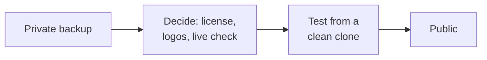

# Before making this public

What to do before open-sourcing AI Usage Meter. None of it blocks a **private**
GitHub backup; that only needs [the last section](#before-any-push-even-private).



---

## 1. Decide

### License

With no license, nobody else may use the code.

| License | In simple words |
|---|---|
| **MIT** | Anyone can do anything, just keep your name. Most common for small apps. |
| **Apache 2.0** | Like MIT, plus protection around patents. |
| **GPL-3.0** | Anyone can use it, but a shared changed version must also be open source. |

GitHub can add one for you: **Add file → Create new file → name it `LICENSE` →
Choose a license template**.

### Logos

`assets/claude.svg` and `assets/openai.svg` come from Simple Icons (CC0), but the
logos are **trademarks**. See [assets/README.md](../assets/README.md).
- Keep the "not made by or connected to Anthropic or OpenAI" line in the README.
- If either company objects, swap in plain text labels.

### The claude.ai sign-in

Claude's numbers come from claude.ai's own usage endpoints, read from inside a
sign-in window the app owns. Before publishing, decide:

- **Are you comfortable shipping an embedded sign-in?** Users should be told
  plainly whose page they are typing a password into. The README and SECURITY.md
  say so; keep that prominent.
- **Anthropic's terms.** These endpoints are not a published API. Using them for a
  personal read-only usage meter is the same thing several App Store apps do, but
  it is not a documented, supported interface, and Anthropic could object or
  change it.
- **Google sign-in doesn't work** inside embedded windows. Keep that in the README.

### The backup check

api.anthropic.com is rate-limited and unpublished. It's **off by default**.
Decide whether to ship it at all, or leave claude.ai plus the status line.

---

## 2. Set up the GitHub repository

- [ ] **Turn on private vulnerability reporting:** Settings → Code security →
      Private vulnerability reporting. SECURITY.md tells people to use it.
- [ ] **Add a build check:** a GitHub Actions workflow on a macOS runner that runs
      `./build-app.sh` and `./scripts/run-tests.sh`.
- [ ] Add a short description and topics (macos, menubar, claude, codex).

## 3. Clean up

- [ ] **Keep `assets/app-icon.svg`.** It's the editable source of the app icon.
- [ ] Decide on `assets/matchstick-concept.svg`, an unused icon idea. Keep it as a
      design record, or remove it.
- [ ] Consider a unique bundle id instead of `local.aiusagemeter`, like
      `io.github.prajwalsr.aiusagemeter`. Change it in `build-app.sh` and in the
      `defaults write` command in the README.

## 4. Test like a new user

- [ ] Clone into a new folder and follow the README exactly
- [ ] Try with **only** Codex installed, and with **only** Claude Code installed
- [ ] Try with live check off, then on, then Deny at the Keychain popup
- [ ] Check that the screenshots still match the app (`./scripts/render-screenshots.sh`)

## 5. Optional: ready-made downloads

To share a `.app` that opens without warnings you need the Apple Developer Program
($99/year), a Developer ID signature with Hardened Runtime, and notarization. Not
needed if people build from source.

---

## Before any push, even private

```bash
# 1. Tests pass
./scripts/run-tests.sh

# 2. No personal info or tokens in the files
grep -rnIE "sk-ant|Bearer [A-Za-z0-9]|/Users/[a-z]|@gmail" \
  --exclude-dir=build --exclude-dir=.build --exclude-dir=.git --exclude=SECURITY.md .

# 3. See exactly what would be committed
git add -A
git status
```

In `git status`, make sure **none** of these appear:
- `build/` or `.build/`
- any `.sqlite`, `.db` or `Cache.db` file
- any `.jsonl` file (session logs)
- `claude.json`, `claude-live.json`, `auth.json`

They're all in `.gitignore`, but check anyway before you commit.
